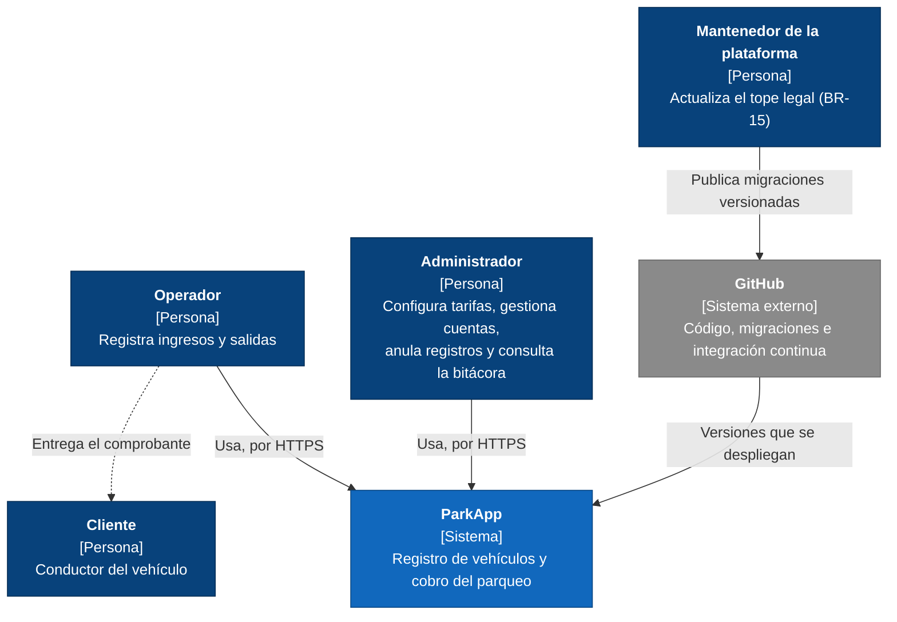
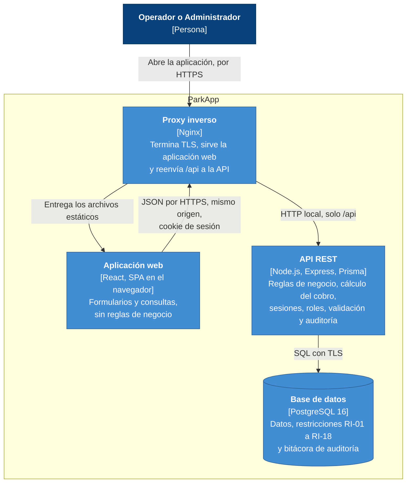

# Arquitectura

| Campo | Valor |
|---|---|
| Proyecto | ParkApp — Sistema de Gestión de Parqueaderos |
| Tarea | S1-06 (#7) |
| Versión | 0.1 — 14 de octubre de 2026 (en construcción) |

Este documento describe la arquitectura de ParkApp con el modelo C4 (contexto,
contenedores y componentes) y una vista de despliegue en AWS. Las decisiones
importantes se registran como ADR (registros de decisiones de arquitectura) en
`docs/adr/`.

## 1. Requisitos que determinan la arquitectura

| Requisito | Qué exige de la arquitectura |
|---|---|
| Un solo parqueadero y 20 usuarios concurrentes (NFR-13) | Una escala pequeña, que no justifica distribuir el sistema. |
| Revocación inmediata de sesiones (NFR-04) | El servidor consulta el estado de la sesión en cada petición. |
| Horas asignadas por el servidor (BR-16) | Toda regla de negocio y todo cálculo ocurren en el backend; el frontend solo presenta. |
| Autorización y validación en el servidor (NFR-05, NFR-06) | La API no confía en el cliente: verifica el rol y valida cada entrada. |
| Solo HTTPS (NFR-09) | El sistema termina TLS en su borde de entrada. |
| Integridad y trazabilidad (RI-01 a RI-18, NFR-12) | Las reglas críticas se cumplen en la base de datos, además de en la API. |
| Disponibilidad del 99 % (NFR-16) | Reinicio automático y respaldos; no se requiere alta disponibilidad en varias zonas. |
| Costo máximo de USD 30 al mes (NFR-23) | Pocos servicios administrados, y de bajo costo. |

## 2. Estilo arquitectónico

ParkApp es un sistema cliente-servidor de tres niveles: una aplicación web de
una sola página (SPA) en React, que corre en el navegador; una API REST en
Node.js con Express y Prisma; y una base de datos PostgreSQL.

- La API es un **monolito modular por capas** (ADR 0001).
- La aplicación web y la API se sirven desde el **mismo origen** (ADR 0002).
- La sesión usa un **token aleatorio en una cookie `HttpOnly`** (ADR 0003).

## 3. Diagrama de contexto (C4, nivel 1)

El cliente no usa el sistema: recibe el comprobante del operador. El mantenedor
tampoco usa la aplicación: el tope legal solo cambia por migraciones versionadas
en el repositorio (BR-15).

## 4. Diagrama de contenedores (C4, nivel 2)

| Contenedor | Tecnología | Responsabilidad | Dónde corre |
|---|---|---|---|
| Proxy inverso | Nginx | Termina TLS, sirve la aplicación web, reenvía `/api` a la API y agrega encabezados de seguridad. | EC2 |
| Aplicación web | React | Interfaz de usuario. No contiene reglas de negocio ni cálculos (BR-16). | Navegador |
| API REST | Node.js, Express, Prisma | Reglas de negocio, cálculo del cobro, sesiones, control de acceso por rol, validación de entradas y auditoría. Un gestor de procesos la reinicia si falla (NFR-17). | EC2 |
| Base de datos | PostgreSQL 16 | Persistencia, restricciones de integridad y bitácora de auditoría. | Amazon RDS, en una subred privada |

## 5. Componentes de la API (C4, nivel 3)

Pendiente.

## 6. Despliegue en AWS

Pendiente.

## 7. Decisiones de arquitectura

| ADR | Decisión |
|---|---|
| [0001](adr/0001-monolito-modular.md) | Monolito modular por capas |
| [0002](adr/0002-mismo-origen.md) | Aplicación web y API en el mismo origen |
| [0003](adr/0003-sesion-en-cookie.md) | Sesión con token aleatorio en una cookie `HttpOnly` |