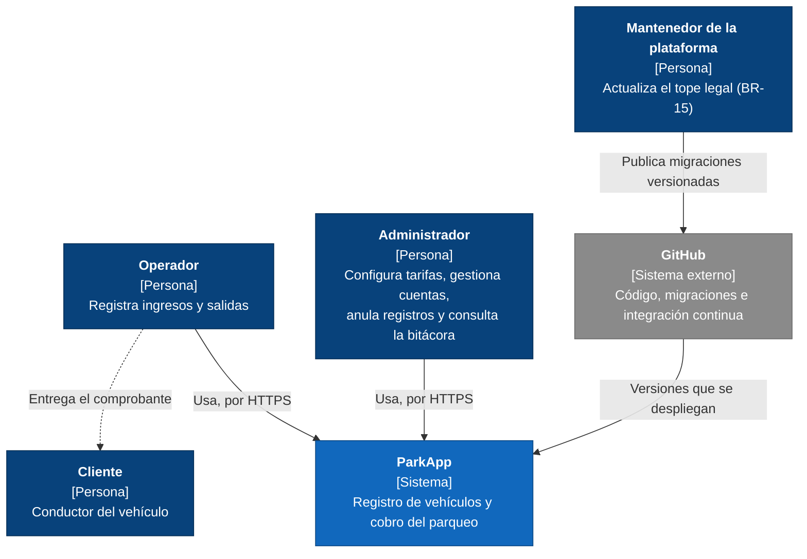
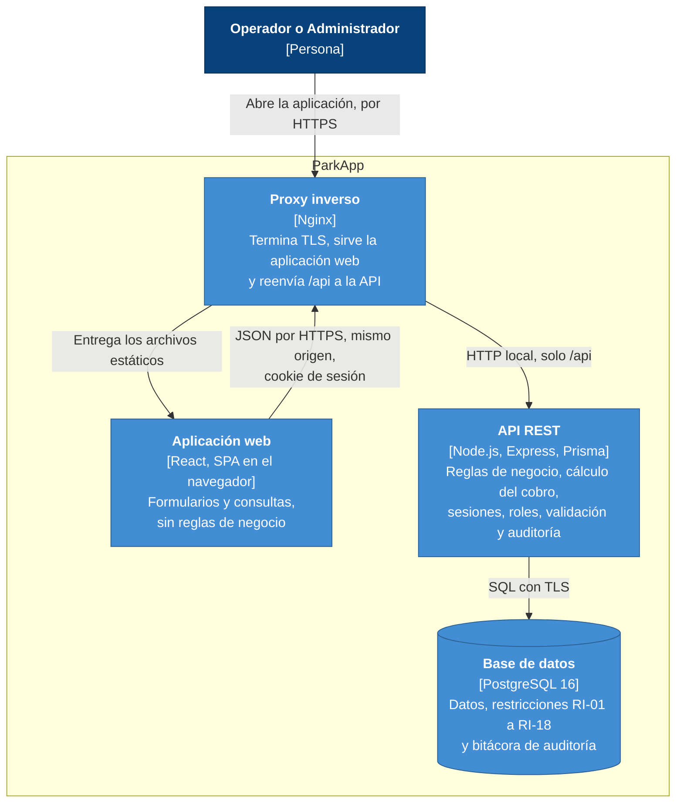
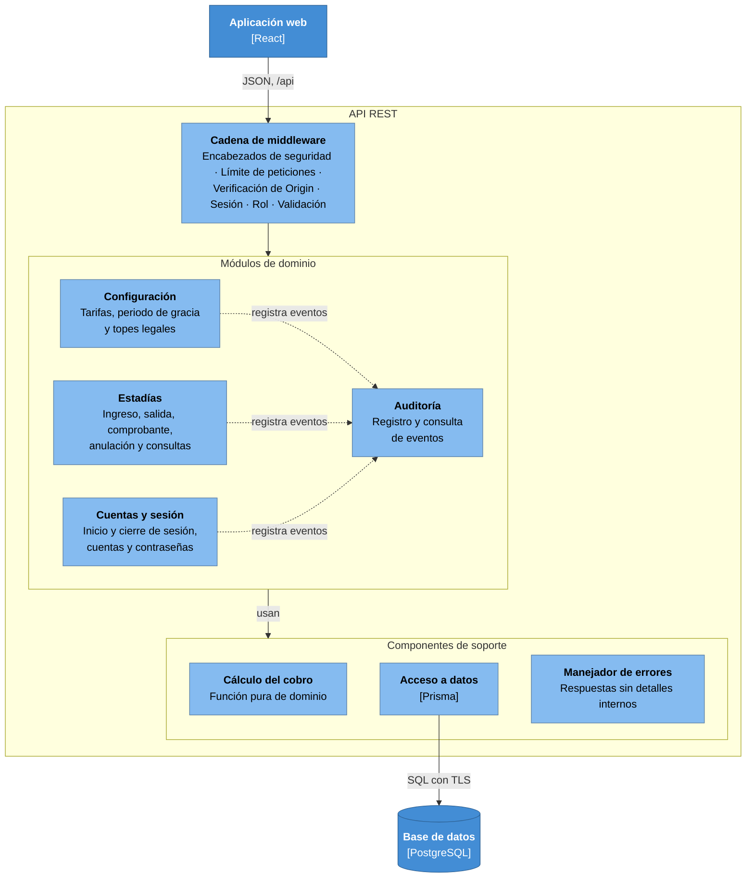
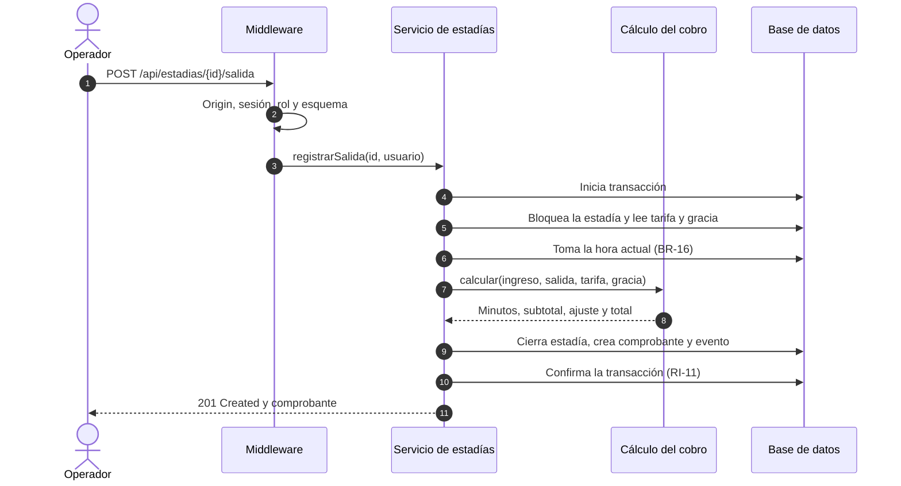

# Arquitectura

| Campo | Valor |
|---|---|
| Proyecto | ParkApp — Sistema de Gestión de Parqueaderos |
| Tarea | S1-06 (#7) |
| Versión | 0.1 — 14 de octubre de 2026 (en construcción) |

Este documento describe la arquitectura de ParkApp con el modelo C4 (contexto,
contenedores y componentes) y una vista de despliegue en AWS. Las decisiones
importantes se registran como ADR (registros de decisiones de arquitectura) en
`docs/adr/`.

## 1. Requisitos que determinan la arquitectura

| Requisito | Qué exige de la arquitectura |
|---|---|
| Un solo parqueadero y 20 usuarios concurrentes (NFR-13) | Una escala pequeña, que no justifica distribuir el sistema. |
| Revocación inmediata de sesiones (NFR-04) | El servidor consulta el estado de la sesión en cada petición. |
| Horas asignadas por el servidor (BR-16) | Toda regla de negocio y todo cálculo ocurren en el backend; el frontend solo presenta. |
| Autorización y validación en el servidor (NFR-05, NFR-06) | La API no confía en el cliente: verifica el rol y valida cada entrada. |
| Solo HTTPS (NFR-09) | El sistema termina TLS en su borde de entrada. |
| Integridad y trazabilidad (RI-01 a RI-18, NFR-12) | Las reglas críticas se cumplen en la base de datos, además de en la API. |
| Disponibilidad del 99 % (NFR-16) | Reinicio automático y respaldos; no se requiere alta disponibilidad en varias zonas. |
| Costo máximo de USD 30 al mes (NFR-23) | Pocos servicios administrados, y de bajo costo. |

## 2. Estilo arquitectónico

ParkApp es un sistema cliente-servidor de tres niveles: una aplicación web de
una sola página (SPA) en React, que corre en el navegador; una API REST en
Node.js con Express y Prisma; y una base de datos PostgreSQL.

- La API es un **monolito modular por capas** (ADR 0001).
- La aplicación web y la API se sirven desde el **mismo origen** (ADR 0002).
- La sesión usa un **token aleatorio en una cookie `HttpOnly`** (ADR 0003).

## 3. Diagrama de contexto (C4, nivel 1)



El cliente no usa el sistema: recibe el comprobante del operador. El mantenedor
tampoco usa la aplicación: el tope legal solo cambia por migraciones versionadas
en el repositorio (BR-15).

## 4. Diagrama de contenedores (C4, nivel 2)



| Contenedor | Tecnología | Responsabilidad | Dónde corre |
|---|---|---|---|
| Proxy inverso | Nginx | Termina TLS, sirve la aplicación web, reenvía `/api` a la API y agrega encabezados de seguridad. | EC2 |
| Aplicación web | React | Interfaz de usuario. No contiene reglas de negocio ni cálculos (BR-16). | Navegador |
| API REST | Node.js, Express, Prisma | Reglas de negocio, cálculo del cobro, sesiones, control de acceso por rol, validación de entradas y auditoría. Un gestor de procesos la reinicia si falla (NFR-17). | EC2 |
| Base de datos | PostgreSQL 16 | Persistencia, restricciones de integridad y bitácora de auditoría. | Amazon RDS, en una subred privada |

## 5. Componentes de la API (C4, nivel 3)



### 5.1 Componentes

| Componente | Responsabilidad | Requisitos |
|---|---|---|
| Cadena de middleware | Procesa cada petición, en este orden: encabezados de seguridad; límite de peticiones; verificación del encabezado `Origin` en las peticiones que modifican datos; sesión (busca el hash del token, verifica que no esté revocada ni expirada y actualiza la última actividad); cambio obligatorio de contraseña (si el usuario debe cambiarla, solo se le permite eso); rol, según la matriz de permisos, respondiendo 403 y registrando `ACCESO_DENEGADO`; y validación de la entrada contra un esquema. | NFR-04, NFR-05, NFR-06, NFR-08, RI-16; ADR 0003 |
| Cuentas y sesión | Inicio y cierre de sesión, creación, desactivación y reactivación de cuentas, y cambio y restablecimiento de contraseñas. | FR-01 a FR-06 |
| Estadías | Ingreso, salida con su comprobante, anulación, consulta de vehículos dentro, búsqueda por placa, historial y resumen de recaudo. | FR-07 a FR-15, FR-18, FR-20 |
| Configuración | Versiones de tarifa y de periodo de gracia. Los topes legales son de solo lectura (BR-15). | FR-16, FR-17 |
| Auditoría | Registra los eventos que le envían los demás módulos y permite consultarlos. Los eventos de una acción exitosa se registran en la misma transacción de la acción. Los de una acción rechazada (inicio de sesión fallido, acceso denegado o ingreso rechazado) se registran aparte, para que queden aunque la acción no ocurra. | FR-19, NFR-12 |
| Cálculo del cobro | Función pura: recibe la hora de ingreso, la hora de salida, la tarifa y el periodo de gracia, y devuelve los minutos completos, el subtotal, el ajuste y el total. No accede a la base de datos ni al reloj del sistema. | BR-05 a BR-08, NFR-20 |
| Acceso a datos | Único componente que usa Prisma y habla con la base de datos. | — |
| Manejador de errores | Convierte cualquier error en una respuesta sin detalles internos, y deja el detalle solo en los registros del servidor. | NFR-07 |

### 5.2 Reglas de dependencia

1. Las rutas solo reciben la petición ya validada y delegan en el servicio. Las
   reglas de negocio están en los servicios.
2. Los servicios no conocen HTTP, así que se pueden probar sin levantar el
   servidor.
3. Solo la capa de acceso a datos usa Prisma.
4. Un módulo no lee ni escribe las tablas de otro: usa el servicio de ese módulo
   (ADR 0001). La única excepción es Auditoría, que todos los módulos llaman para
   registrar eventos.

### 5.3 Flujo de ejemplo: registrar una salida



La hora de salida es la de la base de datos, nunca la que envía el cliente
(BR-16). El cierre de la estadía, el comprobante y el evento de auditoría
quedan en una sola transacción: si algo falla, no queda ninguno (RI-11).

### 5.4 Concurrencia

Varios operadores pueden intentar la misma operación al mismo tiempo. La
integridad no depende de que la API lo evite: la base de datos resuelve la
carrera.

- **Dos ingresos simultáneos de la misma placa:** el índice único parcial de
  RI-02 acepta el primero y rechaza el segundo. La API responde 409 y registra
  `INGRESO_RECHAZADO_PLACA_ACTIVA`.
- **Dos salidas simultáneas de la misma estadía:** la segunda espera a que se
  libere el bloqueo de la fila. Cuando lo obtiene, la estadía ya está cerrada y
  la API responde 409. Además, el comprobante es único por estadía (RI-11).

### 5.5 Estructura del código

Los nombres de carpetas siguen el glosario en inglés.

```
backend/src/
├── modules/
│   ├── accounts/      rutas, esquemas, servicio y acceso a datos
│   ├── stays/
│   ├── settings/
│   └── audit/
├── domain/
│   └── fee-calculation/   función pura y sus pruebas
├── middleware/
└── app                cadena de middleware y registro de rutas
```

## 6. Despliegue en AWS

Pendiente.

## 7. Decisiones de arquitectura

| ADR | Decisión |
|---|---|
| [0001](adr/0001-monolito-modular.md) | Monolito modular por capas |
| [0002](adr/0002-mismo-origen.md) | Aplicación web y API en el mismo origen |
| [0003](adr/0003-sesion-en-cookie.md) | Sesión con token aleatorio en una cookie `HttpOnly` |