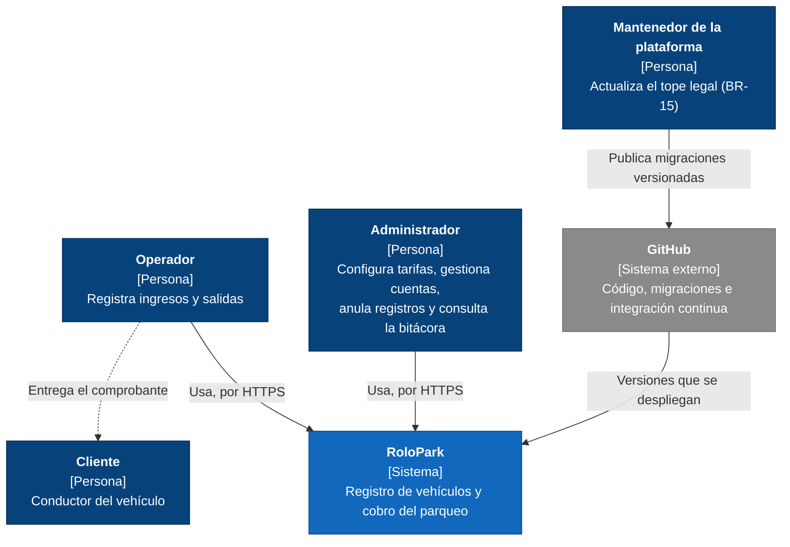
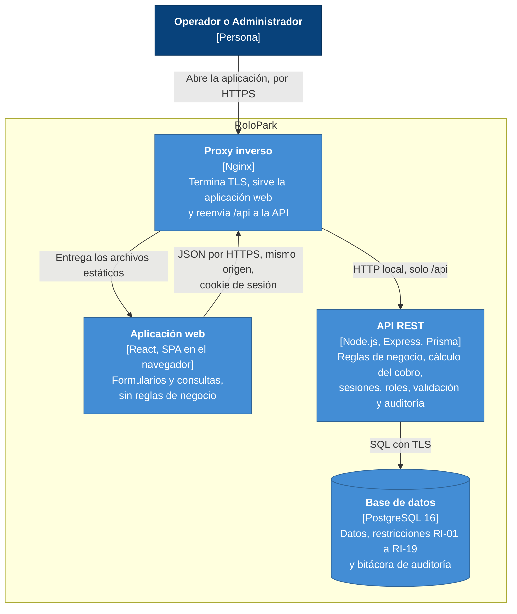
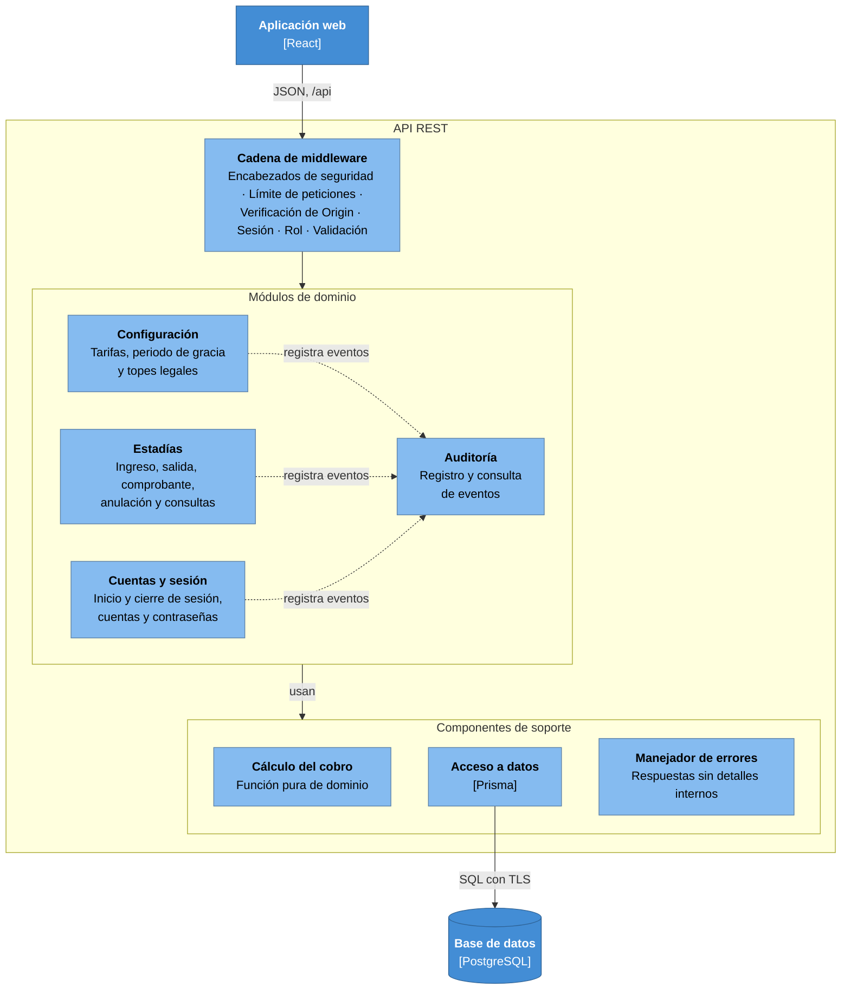
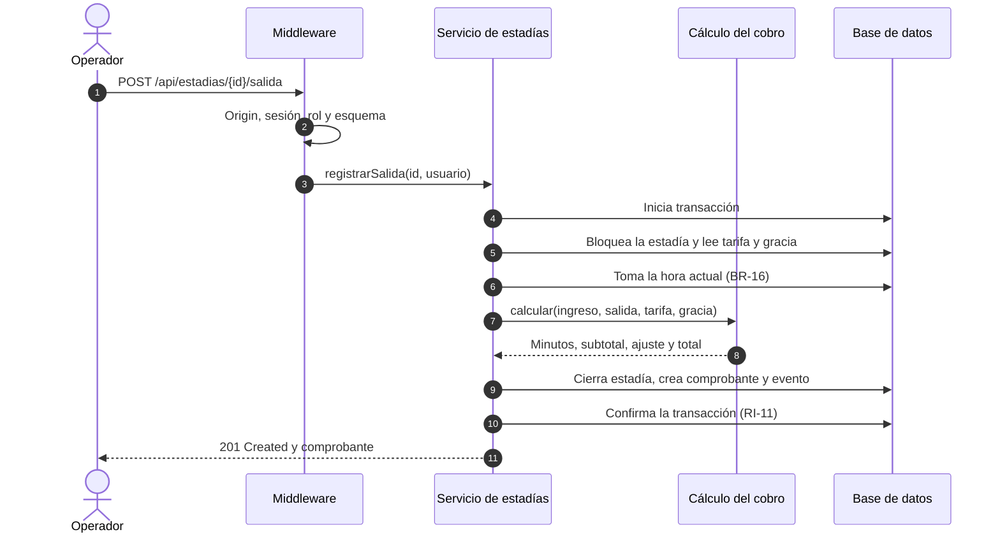
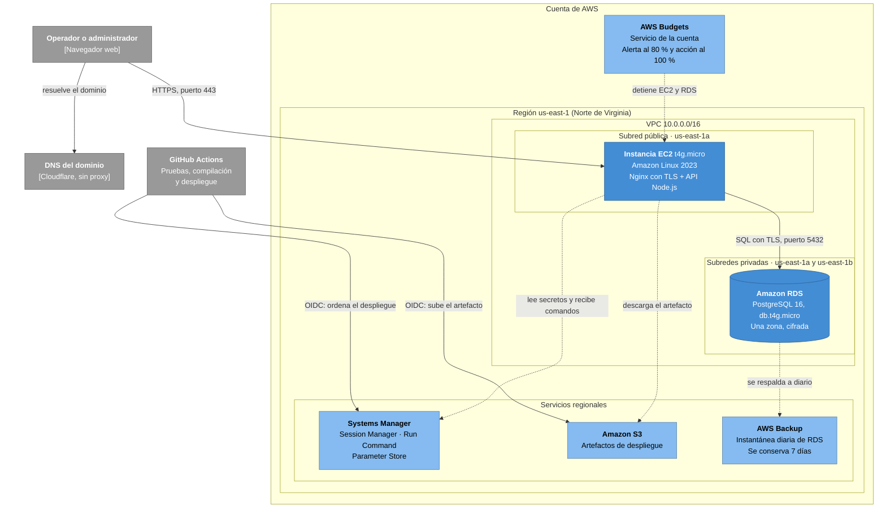

# Arquitectura

| Campo | Valor |
|---|---|
| Proyecto | RoloPark — Sistema de Gestión de Parqueaderos |
| Tarea | S1-06 (#7), S2-14 (#43), S2-20 (#60), S2-21 (#64), S2-23 (#71), S3-02 (#69), S3-12 (#126), S3-13 (#127), S3-14 (#128), S3-15 (#131) |
| Versión | 1.9 — 26 de noviembre de 2026 |

Este documento describe la arquitectura de RoloPark con el modelo C4 (contexto,
contenedores y componentes) y una vista de despliegue en AWS. Las decisiones
importantes se registran como ADR (registros de decisiones de arquitectura) en
`docs/adr/`.

## 1. Requisitos que determinan la arquitectura

| Requisito | Qué exige de la arquitectura |
|---|---|
| Un solo parqueadero y 20 usuarios concurrentes (NFR-13) | Una escala pequeña, que no justifica distribuir el sistema. |
| Revocación inmediata de sesiones (NFR-04) | El servidor consulta el estado de la sesión en cada petición. |
| Horas asignadas por el servidor (BR-16) | Toda regla de negocio y todo cálculo ocurren en el backend; el frontend solo presenta. |
| Autorización y validación en el servidor (NFR-05, NFR-06) | La API no confía en el cliente: verifica el rol y valida cada entrada. |
| Solo HTTPS (NFR-09) | El sistema termina TLS en su borde de entrada. |
| Integridad y trazabilidad (RI-01 a RI-19, NFR-12) | Las reglas críticas se cumplen en la base de datos, además de en la API. |
| Disponibilidad del 99 % (NFR-16) | Reinicio automático y respaldos; no se requiere alta disponibilidad en varias zonas. |
| Costo máximo de USD 30 al mes (NFR-23) | Pocos servicios administrados, y de bajo costo. |

## 2. Estilo arquitectónico

RoloPark es un sistema cliente-servidor de tres niveles: una aplicación web de
una sola página (SPA) en React, que corre en el navegador; una API REST en
Node.js con Express y Prisma; y una base de datos PostgreSQL.

RoloPark es el nombre visible del producto. Los identificadores internos
(repositorio, paquetes, recursos de AWS, roles de la base de datos, parámetros
y servicio) siguen como `parkapp` (ADR 0010).

- La API es un **monolito modular por capas** (ADR 0001).
- La aplicación web y la API se sirven desde el **mismo origen** (ADR 0002).
- La sesión usa un **token aleatorio en una cookie `HttpOnly`** (ADR 0003).

## 3. Diagrama de contexto (C4, nivel 1)



El cliente no usa el sistema: recibe el comprobante del operador. El mantenedor
tampoco usa la aplicación: el tope legal solo cambia por migraciones versionadas
en el repositorio (BR-15).

## 4. Diagrama de contenedores (C4, nivel 2)



| Contenedor | Tecnología | Responsabilidad | Dónde corre |
|---|---|---|---|
| Proxy inverso | Nginx | Termina TLS, sirve la aplicación web, reenvía `/api` a la API y agrega encabezados de seguridad. | EC2 |
| Aplicación web | React | Interfaz de usuario. No contiene reglas de negocio ni cálculos (BR-16). | Navegador |
| API REST | Node.js, Express, Prisma | Reglas de negocio, cálculo del cobro, sesiones, control de acceso por rol, validación de entradas y auditoría. Un gestor de procesos la reinicia si falla (NFR-17). | EC2 |
| Base de datos | PostgreSQL 16 | Persistencia, restricciones de integridad y bitácora de auditoría. | Amazon RDS, en una subred privada |

## 5. Componentes de la API (C4, nivel 3)



### 5.1 Componentes

| Componente | Responsabilidad | Requisitos |
|---|---|---|
| Cadena de middleware | Procesa cada petición, en este orden: encabezados de seguridad; límite de peticiones; verificación del encabezado `Origin` en las peticiones que modifican datos; sesión (busca el hash del token, verifica que no esté revocada ni expirada y actualiza la última actividad); cambio obligatorio de contraseña (si el usuario debe cambiarla, solo se le permite eso); rol, según la matriz de permisos, respondiendo 403 y registrando `ACCESO_DENEGADO`; y validación de la entrada contra un esquema. | NFR-04, NFR-05, NFR-06, NFR-08, RI-16; ADR 0003 |
| Cuentas y sesión | Inicio y cierre de sesión, creación, desactivación y reactivación de cuentas, y cambio y restablecimiento de contraseñas. | FR-01 a FR-06 |
| Estadías | Ingreso, salida con su comprobante, anulación, corrección por reemplazo, consulta de vehículos dentro, búsqueda por placa, historial y resumen de recaudo. | FR-07 a FR-15, FR-18, FR-20 a FR-22 |
| Configuración | Versiones de tarifa y de periodo de gracia. Los topes legales son de solo lectura (BR-15). | FR-16, FR-17 |
| Auditoría | Registra los eventos que le envían los demás módulos y permite consultarlos. Los eventos de una acción exitosa se registran en la misma transacción de la acción. Los de una acción rechazada (inicio de sesión fallido, acceso denegado o ingreso rechazado) se registran aparte, para que queden aunque la acción no ocurra. | FR-19, NFR-12 |
| Cálculo del cobro | Función pura: recibe la hora de ingreso, la hora de salida, la tarifa y el periodo de gracia, y devuelve los minutos completos, el subtotal, el ajuste y el total. No accede a la base de datos ni al reloj del sistema. | BR-05 a BR-08, NFR-20 |
| Acceso a datos | Único componente que usa Prisma y habla con la base de datos. | — |
| Manejador de errores | Convierte cualquier error en una respuesta sin detalles internos, y deja el detalle solo en los registros del servidor. | NFR-07 |

### 5.2 Reglas de dependencia

1. Las rutas solo reciben la petición ya validada y delegan en el servicio. Las
   reglas de negocio están en los servicios.
2. Los servicios no conocen HTTP, así que se pueden probar sin levantar el
   servidor.
3. Solo la capa de acceso a datos usa Prisma.
4. Un módulo no lee ni escribe las tablas de otro: usa el servicio de ese módulo
   (ADR 0001). La única excepción es Auditoría, que todos los módulos llaman para
   registrar eventos.

### 5.3 Flujo de ejemplo: registrar una salida



La hora de salida es la de la base de datos, nunca la que envía el cliente
(BR-16). El cierre de la estadía, el comprobante y el evento de auditoría
quedan en una sola transacción: si algo falla, no queda ninguno (RI-11).

### 5.4 Concurrencia

Varios operadores pueden intentar la misma operación al mismo tiempo. La
integridad no depende de que la API lo evite: la base de datos resuelve la
carrera.

- **Dos ingresos simultáneos de la misma placa:** el índice único parcial de
  RI-02 acepta el primero y rechaza el segundo. La API responde 409 y registra
  `INGRESO_RECHAZADO_PLACA_ACTIVA`.
- **Dos salidas simultáneas de la misma estadía:** la segunda espera a que se
  libere el bloqueo de la fila. Cuando lo obtiene, la estadía ya está cerrada y
  la API responde 409. Además, el comprobante es único por estadía (RI-11).

### 5.5 Estructura del código

Los nombres de carpetas siguen el glosario en inglés.

```
backend/src/
├── modules/
│   ├── accounts/          rutas, esquemas, servicio y acceso a datos
│   ├── stays/
│   ├── settings/
│   ├── audit/
│   └── health/            verificación de salud (GET /api/salud)
├── domain/
│   └── fee-calculation/   función pura y sus pruebas
├── middleware/
├── generated/             cliente de Prisma generado (no se versiona)
├── app.ts                 cadena de middleware y registro de rutas
├── config.ts              lectura y validación de las variables de entorno
├── db.ts                  creación del cliente de Prisma
└── server.ts              arranque en 127.0.0.1 y cierre ordenado
```
Las pruebas van junto al código que prueban, con el sufijo .test.ts.

## 6. Despliegue en AWS

Esta sección es la vista de despliegue: dónde corre cada contenedor de la sección 4 y qué controles lo protegen. Las decisiones se justifican en los ADR 0004 a 0007 y 0009.

### 6.1 Diagrama de despliegue



Desde internet solo se llega al puerto 443 del servidor. La base de datos no tiene dirección pública. Ni la administración (Session Manager) ni el despliegue (GitHub Actions) abren puertos en la instancia.

### 6.2 Recursos

| Recurso | Configuración | Requisitos |
|---|---|---|
| Región | us-east-1 (Norte de Virginia). | NFR-23 · ADR 0004 |
| Red (VPC) | `10.0.0.0/16`. Una subred pública (`10.0.1.0/24`, us-east-1a) con salida a internet. Dos subredes privadas sin ruta a internet: `10.0.11.0/24` en us-east-1a y `10.0.12.0/24` en us-east-1b. RDS exige subredes en dos zonas aunque la base de datos use una sola. Sin NAT Gateway. | NFR-09, NFR-23 |
| Servidor | EC2 `t4g.micro` (2 vCPU, 1 GB) con Amazon Linux 2023. Disco gp3 de 8 GB cifrado, 1 GB de memoria de intercambio, metadatos solo con IMDSv2 e IP elástica. Lleva la etiqueta `Proyecto=parkapp`, que el rol de GitHub Actions exige para enviarle comandos (sección 6.4). Nginx termina TLS, sirve la aplicación web y reenvía `/api` a la API, que escucha solo en `127.0.0.1:3000`. La API es un servicio de systemd que corre con un usuario sin privilegios y `Restart=always`. Endurecimiento adicional: metadatos con un límite de un salto, créditos de CPU en modo Estándar (no ilimitado), protección contra terminación (pero no contra detención, para que AWS Budgets pueda detenerla) y sin par de llaves. La unidad de systemd agrega `NoNewPrivileges`, `PrivateTmp`, `ProtectSystem=full` y `ProtectHome`, y el usuario de la API puede leer su código pero no modificarlo. | NFR-09, NFR-17 · ADR 0002, 0004 |
| Base de datos | RDS PostgreSQL 16, `db.t4g.micro`, en una sola zona (us-east-1a, la misma del servidor). 20 GB gp3 cifrados con KMS. Sin acceso público y con TLS obligatorio (`rds.force_ssl = 1`). Respaldos automáticos de RDS con 1 día de retención, el máximo del plan gratuito, que dan la recuperación a un punto en el tiempo; los 7 días los cubre AWS Backup (fila siguiente). Protección contra borrado. Ventana de respaldo de RDS de 2:00 a 2:30 a. m. y mantenimiento los domingos de 3:00 a 3:30 a. m., hora de Bogotá (UTC−5). Las conexiones verifican el certificado del servidor: la de la API, con el paquete global de certificados de RDS; la de las migraciones, con un archivo que solo tiene la raíz de us-east-1, porque el motor de migraciones de Prisma solo confía en el primer certificado del archivo. **La zona horaria de la base debe seguir en UTC:** con el adaptador de PostgreSQL de Prisma, otra zona guarda y lee las fechas corridas (hallazgo de S2-10). | NFR-09, NFR-18 · ADR 0004, 0009 |
| Respaldos | AWS Backup, plan `parkapp-diario`: una instantánea de la base de datos cada día a las 4:30 a. m., hora de Bogotá, que se borra sola a los 7 días, en la bóveda `parkapp-respaldos`. Con los respaldos de RDS, se puede restaurar cualquiera de los últimos 7 días y cualquier segundo de las últimas 24 horas. | NFR-18 · ADR 0009 |
| Secretos | Parameter Store, con parámetros `SecureString` bajo `/parkapp/prod/`. La API lee su conexión al arrancar y la guarda solo en la memoria del proceso. La contraseña del usuario maestro está bajo `/parkapp/admin/`, fuera del alcance del servidor. | NFR-10 · ADR 0006 |
| Artefactos | Bucket S3 privado, con bloqueo de acceso público, cifrado SSE-S3 y una política que rechaza las peticiones sin TLS. Los artefactos se borran a los 30 días. | NFR-09 · ADR 0007 |
| Dominio y DNS | `rolopark.com` en Cloudflare Registrar. Un registro A apunta a la IP elástica y un CNAME `www` al dominio, los dos sin el proxy de Cloudflare. Un registro CAA solo autoriza a Let's Encrypt a emitir certificados; para que Cloudflare no agregue otras autoridades, su Universal SSL está desactivado. DNSSEC activo. | ADR 0005, 0010 |
| Certificado TLS | Let's Encrypt con certbot, ECDSA, para `rolopark.com` y `www.rolopark.com`. Se renueva con el temporizador `certbot-renew.timer`, y un hook (`infra/certbot/reload-nginx.sh`) recarga Nginx después de cada renovación. Let's Encrypt ya no avisa por correo antes del vencimiento. Configuración de TLS en la sección 6.3. | NFR-09 · ADR 0005 |
| Presupuesto | AWS Budgets: 30 USD al mes, **sin incluir créditos**, porque con créditos el costo neto siempre da 0 y la alerta nunca se activaría. Alerta por correo al 80 % y, al 100 %, dos acciones automáticas, una que detiene EC2 y otra que detiene RDS, sin pedir aprobación (sección 6.4). La acción frena el gasto, pero no lo detiene de forma permanente: RDS vuelve a encender sola una base de datos detenida a los 7 días (sección 6.8). | NFR-23 |
| Registro de actividad | Historial de eventos de CloudTrail: 90 días, sin costo. | — |

### 6.3 Reglas de red

| Grupo de seguridad | Entrada | Salida |
|---|---|---|
| `parkapp-web` (EC2) | 443/TCP desde cualquier origen. 80/TCP desde cualquier origen, solo para redirigir a HTTPS y para la validación de Let's Encrypt. **Ningún puerto de administración: no se abre el 22.** | 443/TCP hacia internet (actualizaciones, Systems Manager, S3 y Let's Encrypt). 5432/TCP solo hacia `parkapp-db`. |
| `parkapp-db` (RDS) | 5432/TCP solo desde `parkapp-web`. | Ninguna. |

Los grupos usan el prefijo `parkapp-` porque AWS no acepta nombres que empiecen por `sg-`. El grupo `default` de la VPC no tiene reglas de entrada ni de salida: si un recurso queda en él por error, no se conecta a nada.

El DNS de la VPC, el servicio de hora y los metadatos de la instancia no pasan por los grupos de seguridad.

**IP real del cliente.** Nginx reemplaza `X-Forwarded-For` por la IP de la conexión (`$remote_addr`), en lugar de agregarla a lo que envíe el cliente, y Express solo confía en el proxy local (`trust proxy = loopback`). Así un cliente no puede falsificar su IP para evadir el límite de peticiones (NFR-08) ni para alterar lo que se registra en la bitácora (NFR-12).

**Nginx.** La configuración está en `infra/nginx/` (`nginx.conf` y `rolopark.conf`) y se aplica a mano en el servidor; el despliegue automático no la toca.

- Una petición por IP o con un nombre que no sea `rolopark.com` o `www.rolopark.com` se rechaza: en el puerto 80 se cierra sin respuesta, y en el 443 se rechaza el saludo TLS. `www` y HTTP redirigen a `https://rolopark.com`.
- TLS 1.2 y 1.3, con las suites ECDSA de la configuración «intermedia» de Mozilla, sin tickets de sesión ni OCSP stapling. El intercambio de llaves prefiere `X25519MLKEM768`, poscuántico, que protege el tráfico grabado hoy contra un descifrado futuro.
- HSTS de dos años con `includeSubDomains` y sin `preload`. `server_tokens off` y cuerpos de petición de máximo 64 kB.
- En todas las respuestas: `Content-Security-Policy: default-src 'self'; base-uri 'none'; object-src 'none'; frame-ancestors 'none'; form-action 'self'`, `X-Content-Type-Options: nosniff` y `Referrer-Policy: same-origin`. Se usa `same-origin` y no `no-referrer` porque con `no-referrer` el navegador envía `Origin: null` en las peticiones del mismo origen, y la API verifica `Origin` contra CSRF (ADR 0003).
- Ningún `location` usa `add_header`, porque en Nginx eso corta la herencia de los encabezados del `server`. La caché se configura con `expires`: `/assets/` se guarda un año (los nombres llevan un hash), e `index.html` se revalida en cada carga.

El [modelo de amenazas](modelo-amenazas.md) relaciona cada uno de estos controles con la amenaza que mitiga.

### 6.4 Identidades y permisos

| Identidad | Puede | Restricción |
|---|---|---|
| Usuario raíz | Solo tareas de la cuenta (plan y facturación). | MFA y sin llaves de acceso. |
| Administrador (persona) | Administrar la cuenta en el trabajo diario. | MFA obligatorio. Es distinto del usuario raíz. |
| Rol del servidor EC2 | Conectarse a Systems Manager (`AmazonSSMManagedInstanceCore`), leer los parámetros de `/parkapp/prod/` y descargar del bucket de artefactos. | No puede modificar otros recursos de AWS. `AmazonSSMManagedInstanceCore` permite leer cualquier parámetro de la cuenta, así que la política propia del rol agrega un Deny explícito sobre todo parámetro fuera de `/parkapp/prod/`; en IAM, un Deny explícito siempre prevalece. |
| Rol de GitHub Actions | Subir al bucket de artefactos y ejecutar el documento `ParkApp-Deploy` en el servidor. | Solo lo puede asumir el repositorio `wrafael91/parkapp` desde la rama `main`, y con credenciales temporales (OIDC). Solo ejecuta `ParkApp-Deploy`, y solo en instancias con la etiqueta `Proyecto=parkapp`. |
| Rol de AWS Budgets | Detener la instancia EC2 y la base de datos. | Solo lo asume AWS Budgets, y solo para presupuestos de esta cuenta. Usa una política propia, no la administrada de AWS, que permite iniciar y detener cualquier instancia: solo puede detener esos dos recursos, solo a través de Systems Manager y solo con los documentos `AWS-StopEC2Instance` y `AWS-StopRdsInstance`. No puede iniciar, modificar ni borrar nada: volver a encenderlos es manual. Se probó de punta a punta con un presupuesto temporal. |
| Rol de AWS Backup | Crear las instantáneas de la base de datos según el plan diario y borrarlas al vencer. | Solo lo asume AWS Backup. Usa la política administrada de AWS Backup con un Deny explícito sobre `rds:ModifyDBInstance` y `rds:ModifyDBCluster`, porque esa política permite modificar cualquier base de datos de la cuenta (ADR 0009). |

### 6.5 Usuarios de la base de datos

| Usuario | Uso | Permisos |
|---|---|---|
| Usuario maestro de RDS | Creación inicial y emergencias. | Todos. Su contraseña solo está en Parameter Store. |
| `parkapp_migrator` | Aplicar las migraciones de Prisma durante el despliegue. | Dueño del esquema: crea y modifica tablas. |
| `parkapp_app` | La API en operación normal. | Solo los que necesita cada tabla, sin crear ni modificar tablas. En la bitácora, únicamente consultar e insertar (NFR-12). |

**Roles y permisos de la base de datos (ADR 0006)**

Los roles se crean con `backend/db/bootstrap/roles.sql`, fuera de las migraciones, porque `parkapp_migrator`, que las ejecuta, no tiene permiso para crear roles. El script es idempotente y crea los roles sin inicio de sesión ni contraseña. Cada entorno los habilita por fuera del repositorio (NFR-10): docker-compose al crear la base local, el CI con una contraseña que solo existe durante la ejecución, y el usuario maestro en RDS con las contraseñas de Parameter Store.

| Rol | Uso |
|---|---|
| `parkapp_migrator` | Dueño del esquema. Solo aplica migraciones. |
| `parkapp_app` | Usuario de la API, con permisos mínimos. |

Permisos de `parkapp_app` (migración `grant_app_privileges`):

| Tabla | SELECT | INSERT | UPDATE | Regla |
|---|---|---|---|---|
| `usuario` | Sí | Sí | Sí | RI-13 (no se borra) |
| `sesion` | Sí | Sí | Sí | — |
| `tope_legal` | Sí | No | No | BR-15 |
| `tarifa` | Sí | Sí | Solo `vigente_hasta` | RI-08 |
| `periodo_gracia` | Sí | Sí | Solo `vigente_hasta` | RI-08 |
| `estadia` | Sí | Sí | Solo los datos de salida y anulación | BR-17 |
| `comprobante` | Sí | Sí | No | RI-12 |
| `evento_auditoria` | Sí | Sí | No | NFR-12 |
| `_prisma_migrations` | No | No | No | Tabla de control de Prisma |

En RDS, el usuario maestro recibió el rol `parkapp_migrator` (`GRANT parkapp_migrator TO <maestro>`), que PostgreSQL 16 exige para que el maestro pueda asignarle la base de datos. La base no concede permisos a PUBLIC: solo `parkapp_migrator` puede conectarse, crear y usar tablas temporales, y `parkapp_app` solo puede conectarse.

Los datos iniciales (la primera cuenta de administrador, la tarifa y el periodo de gracia de un ambiente nuevo) se cargan con los scripts de arranque de `backend/src/scripts/`, que corren en el servidor por Session Manager y se conectan como `parkapp_app`, nunca como el maestro. La contraseña llega por la entrada estándar, de modo que no queda en el historial ni en la lista de procesos. Si nadie puede iniciar sesión como administrador, el script de recuperación (`reset-admin-password.js`) restablece la contraseña de una cuenta de administrador de la misma forma: revoca las sesiones de la cuenta y registra `CONTRASENA_RESTABLECIDA` como evento del sistema (requisitos 1.3, decisión 3).

Ninguna tabla concede DELETE, y las tablas con INSERT conceden USAGE sobre sus secuencias. Cada migración que cree una tabla incluye sus GRANT; no se usa ALTER DEFAULT PRIVILEGES. Una prueba falla si alguna tabla del esquema no concede SELECT a `parkapp_app`, o si `_prisma_migrations` le concede algún permiso.

### 6.6 Flujo de despliegue

1. Al fusionar un pull request en `main`, GitHub Actions ejecuta las pruebas, compila la aplicación web y empaqueta la API (NFR-19).
2. Obtiene credenciales temporales de AWS mediante OIDC. En GitHub no se guarda ninguna llave de AWS (NFR-10).
3. Sube el artefacto a S3, identificado con el hash del commit.
4. Con SSM Run Command, ejecuta en el servidor el documento `ParkApp-Deploy`. Este descarga el artefacto, aplica las migraciones con `parkapp_migrator`, activa la nueva versión y reinicia el servicio.
5. Verifica que `GET /api/salud` responda. Si falla, el documento vuelve a la versión anterior, que se conserva en el servidor.

Detalles del despliegue:

- **Dos jobs.** «Test and package» corre en `ubuntu-24.04-arm` (la arquitectura del servidor), ejecuta las pruebas y los scripts de npm, y no puede pedir credenciales de AWS. «Upload and deploy» es el único con `id-token: write`: sube el artefacto y ejecuta `ParkApp-Deploy`. Los despliegues no se cancelan entre sí.
- **Artefacto.** Un `.tar.gz` con `dist/`, `node_modules/` de producción ya instalado (el servidor no ejecuta `npm ci`), `package.json`, `package-lock.json`, `prisma/`, `prisma7.config.ts`, la aplicación web compilada en `web/` y un archivo `BUILD_INFO` con el commit y la ejecución. La lista es explícita: no entran `src/`, las pruebas ni ningún `.env`. El flujo calcula su SHA-256 y el documento lo verifica antes de extraerlo.
- **Documento `ParkApp-Deploy`** (`infra/ssm/parkapp-deploy.yaml`). Sus parámetros solo aceptan un commit de 7 caracteres hexadecimales y un SHA-256 de 64 (`allowedPattern`), lo que impide inyectar comandos. Toma un candado para que dos despliegues no se crucen, aplica las migraciones como el usuario del sistema de la API con `JITI_FS_CACHE=false` (Prisma no deja archivos en `/tmp`) y conserva solo la versión nueva y la anterior. Si algo falla antes de activar la nueva versión, la que está en servicio no se toca.

Las migraciones se diseñan compatibles con la versión anterior, para que volver atrás no obligue a deshacerlas. Antes de una migración que cambie tablas existentes, se toma un respaldo bajo demanda con AWS Backup, que vence a los 7 días (ADR 0009).

El job de despliegue no usa `environment:` de GitHub Actions. Con esa opción, GitHub cambia el `sub` del token OIDC y el rol de AWS deja de aceptarlo. El rol solo acepta `repo:wrafael91@61667502/parkapp@1403355272:ref:refs/heads/main`: desde 2026, en los repositorios creados después del 15 de julio, GitHub incluye en el `sub` los ID inmutables del dueño y del repositorio, para que un nombre reutilizado no herede la confianza (ADR 0007).

### 6.7 Disponibilidad y respaldos

- AWS compromete 99,5 % de disponibilidad para una instancia individual de EC2 y otro 99,5 % para una base de datos de RDS en una sola zona. Combinados dan cerca de 99,0 %, el mínimo de NFR-16. La disponibilidad real suele ser mayor; el riesgo principal son los propios despliegues y el mantenimiento, y por eso se programan de madrugada.
- Si la API falla, systemd la reinicia en segundos (NFR-17): unos 7 s, medidos el 31 de octubre de 2026.
- **Monitor externo (NFR-16):** desde el 23 de noviembre de 2026, UptimeRobot (plan gratuito) consulta `https://rolopark.com/api/salud` cada 5 minutos y avisa por correo si la respuesta no trae `"estado":"ok"`. Ese endpoint consulta la base (`SELECT 1`), así que el monitor cubre DNS, TLS, Nginx, la API y la base. No vigila el vencimiento del certificado (R8 del modelo de amenazas). La disponibilidad medida se reporta en `docs/evaluacion.md`.
- **Aviso de fallos de los respaldos:** desde el 23 de noviembre de 2026, una regla de EventBridge envía a un tema de SNS, con suscripción de correo, los trabajos de AWS Backup que terminan en `FAILED`, `ABORTED` o `EXPIRED` (S3-14).

**Restauración (NFR-18).** Una restauración crea una nueva instancia de RDS. El procedimiento se probó en el simulacro del 24 y el 26 de noviembre de 2026 (S3-12; resultados en `docs/evaluacion.md`, sección 3, y comandos en `infra/load-test/README.md`):

1. Restaurar a una instancia nueva, por una de dos vías (ADR 0009):
   - a un punto de las últimas 24 horas, para un daño reciente: 10 min 41 s hasta estar disponible, con un RPO de 5 a 7 minutos;
   - desde la instantánea diaria de AWS Backup de cualquiera de los últimos 7 días, para un daño que se descubre tarde: 5 min 36 s hasta estar disponible, con los datos de las 4:30 a. m. de ese día. RDS acepta el punto de recuperación de AWS Backup con el usuario administrador, sin un rol de restauración.

   La instancia nueva va con el grupo de subredes de la base, el grupo de seguridad `parkapp-db`, el grupo de parámetros `parkapp-postgres16`, la CA de RDS y la zona us-east-1a, sin acceso público. En un incidente real lleva también la retención de 1 día y la protección contra borrado de producción (en el simulacro iban en 0 y sin protección, porque se borraba enseguida).
2. Revisar la configuración y comparar los datos con `infra/load-test/verify-restore.sql`.
3. Renombrar la instancia dañada y después la restaurada a `parkapp-db`. Así, la restaurada conserva el endpoint y el ARN, y no cambian los parámetros de `/parkapp/prod/`, la acción de Budgets ni la selección de AWS Backup, que la nombran por su ARN. Apuntar la API a una instancia con otro nombre dejaría la base nueva fuera de la acción de Budgets y de los respaldos diarios. Cada renombre tomó 1 min 20 s, más unos 2 minutos hasta que el nombre nuevo resuelve; el corte completo se estima en 5 a 8 minutos.
4. Reiniciar la API (`sudo systemctl restart parkapp-api`) para que no queden conexiones a la instancia vieja.

En el simulacro, la restauración a un punto en el tiempo tardó 40 minutos hasta que la aplicación respondió sobre la base restaurada, y la de AWS Backup 13 minutos hasta los datos verificados, frente a las 2 horas de NFR-18. El plan gratuito admite 2 instancias de RDS: en un incidente caben la dañada y una restaurada, así que, si una restauración sale mal, hay que borrarla antes de intentar otra.

**Capacidad.** En la prueba de carga (S3-13, `docs/evaluacion.md`, sección 4), con 20 operadores en uso realista, el ingreso respondió en 131 ms en el percentil 95, RDS no pasó del 20 % de CPU y la EC2 del 11 %. En saturación (20 operadores sin pausas), el límite fue la base y el pool de 10 conexiones de la API, no la CPU de la EC2: RDS llegó al 81 % y la EC2 al 21,5 %. Los ingresos simultáneos de un mismo tipo de vehículo se atienden en fila, por el candado de los cupos (BR-19, `docs/modelo-datos.md`, decisión 8), unos 60 ms cada uno, y la transacción que espera conserva su conexión. Si un parqueadero más grande lo necesitara, las mejoras posibles son un pool algo mayor o acortar la parte de la transacción que se hace con el candado tomado. Un pool mayor no elimina la espera del candado, pero evita que los ingresos de un tipo hagan esperar a los del otro y a las salidas.

### 6.8 Costo

| Recurso | USD al mes |
|---|---|
| EC2 `t4g.micro` y disco de 8 GB | 6,77 |
| IP pública | 3,65 |
| RDS `db.t4g.micro` y 20 GB | 13,98 |
| Parameter Store, Systems Manager, OIDC, Budgets y CloudTrail | 0,00 |
| S3 | menos de 0,01 |
| AWS Backup: instantáneas de la base de datos (ADR 0009) | unos centavos |
| **Total** | **24,40** |

Estimación hecha en la [calculadora de precios de AWS](https://calculator.aws/#/estimate?id=3c7ee30438426c32204b0e8a2516dfa7c770911f), en Norte de Virginia y con precios bajo demanda. Queda por debajo del límite de 30 USD de NFR-23. El dominio, `rolopark.com`, se paga aparte: 11,17 USD al año.

**Cuenta y vigencia.** La cuenta usa el plan gratuito de AWS: 100 USD en créditos (hasta 200 con las actividades de inicio) durante 6 meses, sin cobros a la tarjeta. Cuando se agotan los créditos o se cumple el plazo, la cuenta se cierra. El despliegue se mantiene al menos hasta que se publique la nota final. Si hay que apagarlo antes, los recursos se eliminan en lugar de detenerse: un servidor detenido sigue pagando el disco y la IP, y RDS vuelve a encender sola una base de datos detenida a los 7 días.

### 6.9 Opciones descartadas

| Opción | Por qué no |
|---|---|
| RDS en varias zonas | Duplica el costo de la base de datos, y NFR-16 se cumple con una sola zona. |
| Balanceador de carga | Tiene un costo fijo alto para una sola instancia (ADR 0002). |
| NAT Gateway | Cuesta unos 33 USD al mes, y ningún recurso privado necesita salir a internet. |
| AWS WAF | Cobra cada mes por reglas. AWS Shield Standard, incluido sin costo, protege contra los ataques de red más comunes, y el límite de peticiones de la API (NFR-08) cubre el resto del riesgo actual. |
| Proxy de Cloudflare | Protegería contra ataques de denegación de servicio, pero cambia dónde termina TLS y cómo llega la IP del cliente. Queda como mejora futura. |

## 7. Decisiones de arquitectura

| ADR | Decisión |
|---|---|
| [0001](adr/0001-monolito-modular.md) | Monolito modular por capas |
| [0002](adr/0002-mismo-origen.md) | Aplicación web y API en el mismo origen |
| [0003](adr/0003-sesion-en-cookie.md) | Sesión con token aleatorio en una cookie `HttpOnly` |
| [0004](adr/0004-region-y-dimensionamiento.md) | Región us-east-1 con recursos de tamaño mínimo |
| [0005](adr/0005-https-y-dominio.md) | HTTPS con Let's Encrypt en Nginx y dominio en Cloudflare |
| [0006](adr/0006-secretos-en-parameter-store.md) | Secretos en Parameter Store y usuarios de base de datos separados |
| [0007](adr/0007-acceso-y-despliegue-sin-ssh.md) | Administración y despliegue sin SSH ni llaves de larga duración |
| [0008](adr/0008-contrato-de-la-api.md) | Contrato de la API en español y código en inglés |
| [0009](adr/0009-respaldos-con-aws-backup.md) | Respaldos diarios con AWS Backup por el límite del plan gratuito |
| [0010](adr/0010-nombre-visible-rolopark.md) | RoloPark como nombre visible y `parkapp` como identificador interno |

El [modelo de amenazas](modelo-amenazas.md) (S2-13) relaciona cada amenaza con
su control y su estado. Es la referencia vigente donde un ADR remite al modelo
de amenazas de S1-07 (ADR 0003).

## Historial de cambios

| Versión | Fecha | Cambios |
|---|---|---|
| 0.1 | 14 de octubre de 2026 | Secciones 1 a 5 y 7; ADR 0001 a 0003. |
| 1.0 | 17 de octubre de 2026 | Sección 6, despliegue en AWS; ADR 0004 a 0007; diagramas de componentes y de la salida simplificados. |
| 1.1 | 20 de octubre de 2026 | El componente Estadías incluye la corrección por reemplazo (FR-21, FR-22); rango de reglas de integridad hasta RI-19. |
| 1.2 | 22 de octubre de 2026 | Diagrama de despliegue: la cuenta de AWS contiene la región, y AWS Budgets queda a nivel de cuenta. |
| 1.3 | 30 de octubre de 2026 | Estructura de `backend/src` (5.5, #34). Roles y matriz de permisos de la base de datos (6.5, #59). Ajustes de la implementación en AWS (#43): nombres de los grupos de seguridad, Deny explícito en el rol del servidor, etiqueta `Proyecto=parkapp`, bucket solo con HTTPS, `environment:` excluido del despliegue y reencendido de RDS a los 7 días. |
| 1.4 | 2 de noviembre de 2026 | ADR 0008: contrato de la API en español y código en inglés (#60). |
| 1.5 | 2 de noviembre de 2026 | ADR 0009: respaldos diarios con AWS Backup, porque el plan gratuito limita la retención de RDS a 1 día (6.1, 6.2, 6.4, 6.6, 6.7 y 6.8). `sub` de OIDC con los ID inmutables del repositorio (6.6 y ADR 0007). Correcciones: Nginx reemplaza `X-Forwarded-For` (6.3) y costo del dominio `rolopark.com` (6.8). (#64) |
| 1.6 | 12 de noviembre de 2026 | ADR 0010: RoloPark es el nombre visible del producto y los identificadores internos siguen como `parkapp` (secciones 2 a 4). Enlace al modelo de amenazas en la sección 7. (#71) |
| 1.7 | 14 de noviembre de 2026 | Detalles de la implementación de S2-04 a S2-08 y S2-10: endurecimiento del servidor y de systemd, certificados de las conexiones a la base, zona horaria UTC, contraseña del maestro, dominio, renovación del certificado y dos acciones de Budgets (6.2); configuración de Nginx (6.3); rol de Budgets (6.4); permisos de la base y scripts de arranque (6.5); jobs, artefacto y documento de despliegue (6.6). ADR 0004, 0005 y 0006 actualizados. S3-02 (#69) |
| 1.8 | 26 de noviembre de 2026 | Sección 6.7 con los resultados del objetivo 4: monitor externo (NFR-16) y aviso de fallos de los respaldos (S3-14); procedimiento de restauración probado en el simulacro, con el renombre en lugar de cambiar la dirección de la base en `/parkapp/prod/`, las dos vías y sus tiempos, y el cupo de 2 instancias del plan gratuito (S3-12); nota de capacidad con el cuello de botella en saturación (S3-13). Resultados en `docs/evaluacion.md`. S3-12 (#126), S3-13 (#127) y S3-14 (#128) |
| 1.9 | 26 de noviembre de 2026 | Sección 6.5: el script de recuperación restablece la contraseña de una cuenta de administrador por Session Manager, con `parkapp_app`. S3-15 (#131) |
