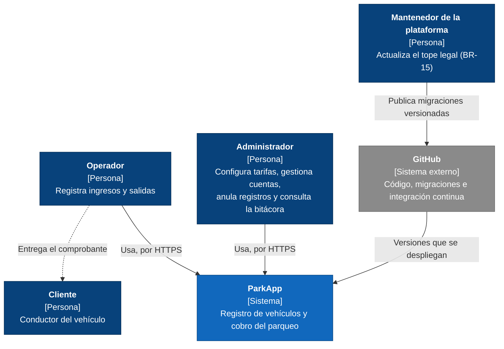
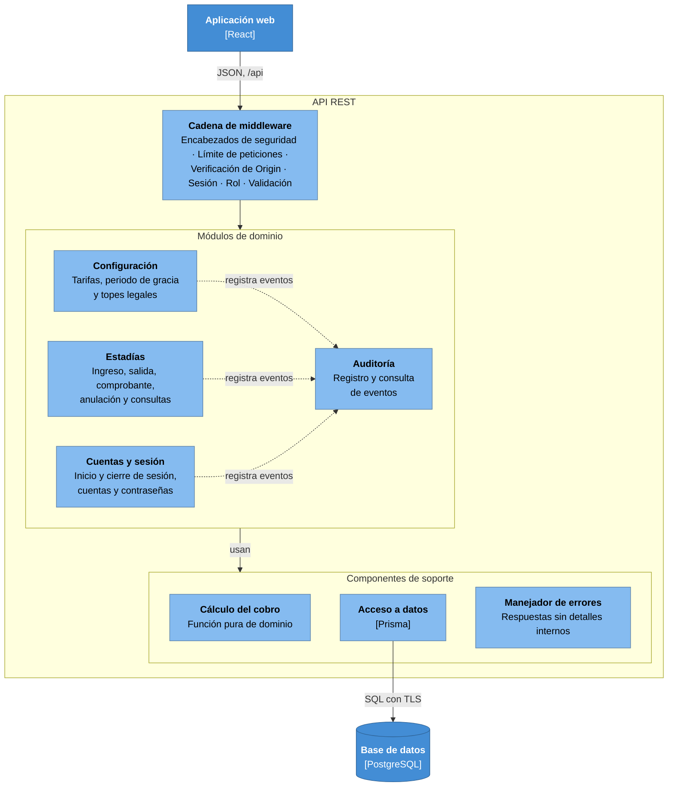
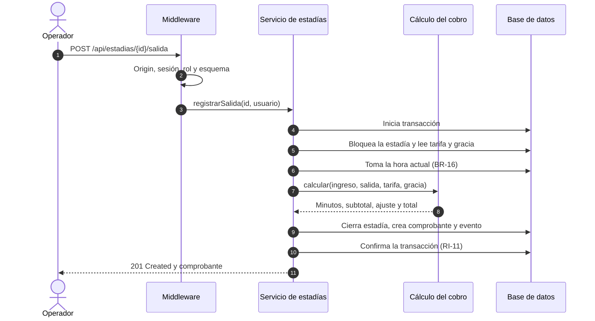
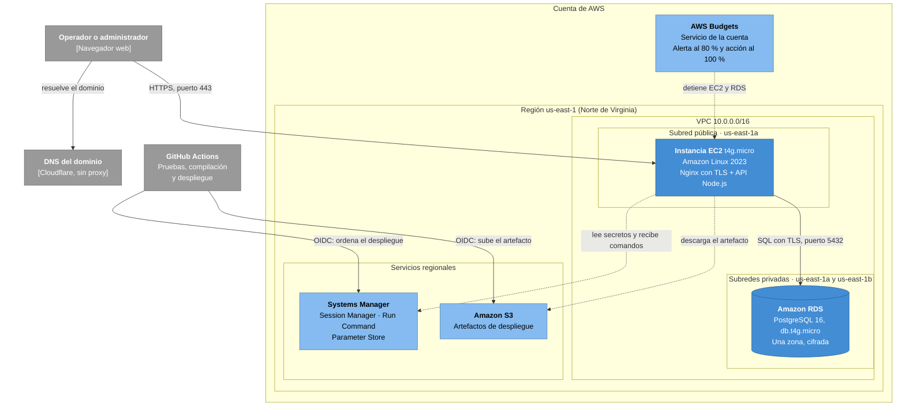

# Arquitectura

| Campo | Valor |
|---|---|
| Proyecto | ParkApp — Sistema de Gestión de Parqueaderos |
| Tarea | S1-06 (#7) |
| Versión | 1.2 — 22 de octubre de 2026 |

Este documento describe la arquitectura de ParkApp con el modelo C4 (contexto,
contenedores y componentes) y una vista de despliegue en AWS. Las decisiones
importantes se registran como ADR (registros de decisiones de arquitectura) en
`docs/adr/`.

## 1. Requisitos que determinan la arquitectura

| Requisito | Qué exige de la arquitectura |
|---|---|
| Un solo parqueadero y 20 usuarios concurrentes (NFR-13) | Una escala pequeña, que no justifica distribuir el sistema. |
| Revocación inmediata de sesiones (NFR-04) | El servidor consulta el estado de la sesión en cada petición. |
| Horas asignadas por el servidor (BR-16) | Toda regla de negocio y todo cálculo ocurren en el backend; el frontend solo presenta. |
| Autorización y validación en el servidor (NFR-05, NFR-06) | La API no confía en el cliente: verifica el rol y valida cada entrada. |
| Solo HTTPS (NFR-09) | El sistema termina TLS en su borde de entrada. |
| Integridad y trazabilidad (RI-01 a RI-19, NFR-12) | Las reglas críticas se cumplen en la base de datos, además de en la API. |
| Disponibilidad del 99 % (NFR-16) | Reinicio automático y respaldos; no se requiere alta disponibilidad en varias zonas. |
| Costo máximo de USD 30 al mes (NFR-23) | Pocos servicios administrados, y de bajo costo. |

## 2. Estilo arquitectónico

ParkApp es un sistema cliente-servidor de tres niveles: una aplicación web de
una sola página (SPA) en React, que corre en el navegador; una API REST en
Node.js con Express y Prisma; y una base de datos PostgreSQL.

- La API es un **monolito modular por capas** (ADR 0001).
- La aplicación web y la API se sirven desde el **mismo origen** (ADR 0002).
- La sesión usa un **token aleatorio en una cookie `HttpOnly`** (ADR 0003).

## 3. Diagrama de contexto (C4, nivel 1)



El cliente no usa el sistema: recibe el comprobante del operador. El mantenedor
tampoco usa la aplicación: el tope legal solo cambia por migraciones versionadas
en el repositorio (BR-15).

## 4. Diagrama de contenedores (C4, nivel 2)


| Contenedor | Tecnología | Responsabilidad | Dónde corre |
|---|---|---|---|
| Proxy inverso | Nginx | Termina TLS, sirve la aplicación web, reenvía `/api` a la API y agrega encabezados de seguridad. | EC2 |
| Aplicación web | React | Interfaz de usuario. No contiene reglas de negocio ni cálculos (BR-16). | Navegador |
| API REST | Node.js, Express, Prisma | Reglas de negocio, cálculo del cobro, sesiones, control de acceso por rol, validación de entradas y auditoría. Un gestor de procesos la reinicia si falla (NFR-17). | EC2 |
| Base de datos | PostgreSQL 16 | Persistencia, restricciones de integridad y bitácora de auditoría. | Amazon RDS, en una subred privada |

## 5. Componentes de la API (C4, nivel 3)



### 5.1 Componentes

| Componente | Responsabilidad | Requisitos |
|---|---|---|
| Cadena de middleware | Procesa cada petición, en este orden: encabezados de seguridad; límite de peticiones; verificación del encabezado `Origin` en las peticiones que modifican datos; sesión (busca el hash del token, verifica que no esté revocada ni expirada y actualiza la última actividad); cambio obligatorio de contraseña (si el usuario debe cambiarla, solo se le permite eso); rol, según la matriz de permisos, respondiendo 403 y registrando `ACCESO_DENEGADO`; y validación de la entrada contra un esquema. | NFR-04, NFR-05, NFR-06, NFR-08, RI-16; ADR 0003 |
| Cuentas y sesión | Inicio y cierre de sesión, creación, desactivación y reactivación de cuentas, y cambio y restablecimiento de contraseñas. | FR-01 a FR-06 |
| Estadías | Ingreso, salida con su comprobante, anulación, corrección por reemplazo, consulta de vehículos dentro, búsqueda por placa, historial y resumen de recaudo. | FR-07 a FR-15, FR-18, FR-20 a FR-22 |
| Configuración | Versiones de tarifa y de periodo de gracia. Los topes legales son de solo lectura (BR-15). | FR-16, FR-17 |
| Auditoría | Registra los eventos que le envían los demás módulos y permite consultarlos. Los eventos de una acción exitosa se registran en la misma transacción de la acción. Los de una acción rechazada (inicio de sesión fallido, acceso denegado o ingreso rechazado) se registran aparte, para que queden aunque la acción no ocurra. | FR-19, NFR-12 |
| Cálculo del cobro | Función pura: recibe la hora de ingreso, la hora de salida, la tarifa y el periodo de gracia, y devuelve los minutos completos, el subtotal, el ajuste y el total. No accede a la base de datos ni al reloj del sistema. | BR-05 a BR-08, NFR-20 |
| Acceso a datos | Único componente que usa Prisma y habla con la base de datos. | — |
| Manejador de errores | Convierte cualquier error en una respuesta sin detalles internos, y deja el detalle solo en los registros del servidor. | NFR-07 |

### 5.2 Reglas de dependencia

1. Las rutas solo reciben la petición ya validada y delegan en el servicio. Las
   reglas de negocio están en los servicios.
2. Los servicios no conocen HTTP, así que se pueden probar sin levantar el
   servidor.
3. Solo la capa de acceso a datos usa Prisma.
4. Un módulo no lee ni escribe las tablas de otro: usa el servicio de ese módulo
   (ADR 0001). La única excepción es Auditoría, que todos los módulos llaman para
   registrar eventos.

### 5.3 Flujo de ejemplo: registrar una salida



La hora de salida es la de la base de datos, nunca la que envía el cliente
(BR-16). El cierre de la estadía, el comprobante y el evento de auditoría
quedan en una sola transacción: si algo falla, no queda ninguno (RI-11).

### 5.4 Concurrencia

Varios operadores pueden intentar la misma operación al mismo tiempo. La
integridad no depende de que la API lo evite: la base de datos resuelve la
carrera.

- **Dos ingresos simultáneos de la misma placa:** el índice único parcial de
  RI-02 acepta el primero y rechaza el segundo. La API responde 409 y registra
  `INGRESO_RECHAZADO_PLACA_ACTIVA`.
- **Dos salidas simultáneas de la misma estadía:** la segunda espera a que se
  libere el bloqueo de la fila. Cuando lo obtiene, la estadía ya está cerrada y
  la API responde 409. Además, el comprobante es único por estadía (RI-11).

### 5.5 Estructura del código

Los nombres de carpetas siguen el glosario en inglés.

```
backend/src/
├── modules/
│   ├── accounts/          rutas, esquemas, servicio y acceso a datos
│   ├── stays/
│   ├── settings/
│   ├── audit/
│   └── health/            verificación de salud (GET /api/salud)
├── domain/
│   └── fee-calculation/   función pura y sus pruebas
├── middleware/
├── generated/             cliente de Prisma generado (no se versiona)
├── app.ts                 cadena de middleware y registro de rutas
├── config.ts              lectura y validación de las variables de entorno
├── db.ts                  creación del cliente de Prisma
└── server.ts              arranque en 127.0.0.1 y cierre ordenado
```
Las pruebas van junto al código que prueban, con el sufijo .test.ts.

## 6. Despliegue en AWS

Esta sección es la vista de despliegue: dónde corre cada contenedor de la sección 4 y qué controles lo protegen. Las decisiones se justifican en los ADR 0004 a 0007.

### 6.1 Diagrama de despliegue



Desde internet solo se llega al puerto 443 del servidor. La base de datos no tiene dirección pública. Ni la administración (Session Manager) ni el despliegue (GitHub Actions) abren puertos en la instancia.

### 6.2 Recursos

| Recurso | Configuración | Requisitos |
|---|---|---|
| Región | us-east-1 (Norte de Virginia). | NFR-23 · ADR 0004 |
| Red (VPC) | `10.0.0.0/16`. Una subred pública (`10.0.1.0/24`, us-east-1a) con salida a internet. Dos subredes privadas sin ruta a internet: `10.0.11.0/24` en us-east-1a y `10.0.12.0/24` en us-east-1b. RDS exige subredes en dos zonas aunque la base de datos use una sola. Sin NAT Gateway. | NFR-09, NFR-23 |
| Servidor | EC2 `t4g.micro` (2 vCPU, 1 GB) con Amazon Linux 2023. Disco gp3 de 8 GB cifrado, 1 GB de memoria de intercambio, metadatos solo con IMDSv2 e IP elástica. Nginx termina TLS, sirve la aplicación web y reenvía `/api` a la API, que escucha solo en `127.0.0.1:3000`. La API es un servicio de systemd que corre con un usuario sin privilegios y `Restart=always`. | NFR-09, NFR-17 · ADR 0002, 0004 |
| Base de datos | RDS PostgreSQL 16, `db.t4g.micro`, en una sola zona (us-east-1a, la misma del servidor). 20 GB gp3 cifrados con KMS. Sin acceso público y con TLS obligatorio (`rds.force_ssl = 1`). Respaldos automáticos con 7 días de retención y recuperación a un punto en el tiempo. Protección contra borrado. Respaldo diario de 2:00 a 2:30 a. m. y mantenimiento los domingos de 3:00 a 3:30 a. m., hora de Bogotá (UTC−5). | NFR-09, NFR-18 · ADR 0004 |
| Secretos | Parameter Store, con parámetros `SecureString` bajo `/parkapp/prod/`. | NFR-10 · ADR 0006 |
| Artefactos | Bucket S3 privado, con bloqueo de acceso público y cifrado. Los artefactos se borran a los 30 días. | ADR 0007 |
| Dominio y DNS | Dominio en Cloudflare Registrar. Un registro A apunta a la IP elástica, sin el proxy de Cloudflare. | ADR 0005 |
| Certificado TLS | Let's Encrypt con certbot y renovación automática. Solo TLS 1.2 y 1.3, con HSTS. | NFR-09 · ADR 0005 |
| Presupuesto | AWS Budgets: 30 USD al mes, **sin incluir créditos**, porque con créditos el costo neto siempre da 0 y la alerta nunca se activaría. Alerta por correo al 80 % y, al 100 %, una acción automática que detiene EC2 y RDS. | NFR-23 |
| Registro de actividad | Historial de eventos de CloudTrail: 90 días, sin costo. | — |

### 6.3 Reglas de red

| Grupo de seguridad | Entrada | Salida |
|---|---|---|
| `sg-web` (EC2) | 443/TCP desde cualquier origen. 80/TCP desde cualquier origen, solo para redirigir a HTTPS y para la validación de Let's Encrypt. **Ningún puerto de administración: no se abre el 22.** | 443/TCP hacia internet (actualizaciones, Systems Manager, S3 y Let's Encrypt). 5432/TCP solo hacia `sg-db`. |
| `sg-db` (RDS) | 5432/TCP solo desde `sg-web`. | Ninguna. |

El DNS de la VPC, el servicio de hora y los metadatos de la instancia no pasan por los grupos de seguridad.

**IP real del cliente.** Nginx agrega la IP del cliente en `X-Forwarded-For`, y Express solo confía en el proxy local (`trust proxy = loopback`). Así un cliente no puede falsificar su IP para evadir el límite de peticiones (NFR-08) ni para alterar lo que se registra en la bitácora (NFR-12).

### 6.4 Identidades y permisos

| Identidad | Puede | Restricción |
|---|---|---|
| Usuario raíz | Solo tareas de la cuenta (plan y facturación). | MFA y sin llaves de acceso. |
| Administrador (persona) | Administrar la cuenta en el trabajo diario. | MFA obligatorio. Es distinto del usuario raíz. |
| Rol del servidor EC2 | Conectarse a Systems Manager (`AmazonSSMManagedInstanceCore`), leer los parámetros de `/parkapp/prod/` y descargar del bucket de artefactos. | No puede modificar otros recursos de AWS. |
| Rol de GitHub Actions | Subir al bucket de artefactos y ejecutar el documento `ParkApp-Deploy` en el servidor. | Solo lo puede asumir el repositorio `wrafael91/parkapp` desde la rama `main`, y con credenciales temporales (OIDC). |
| Rol de AWS Budgets | Detener la instancia EC2 y la base de datos. | Solo sobre esos dos recursos. |

### 6.5 Usuarios de la base de datos

| Usuario | Uso | Permisos |
|---|---|---|
| Usuario maestro de RDS | Creación inicial y emergencias. | Todos. Su contraseña solo está en Parameter Store. |
| `parkapp_migrator` | Aplicar las migraciones de Prisma durante el despliegue. | Dueño del esquema: crea y modifica tablas. |
| `parkapp_app` | La API en operación normal. | Solo los que necesita cada tabla, sin crear ni modificar tablas. En la bitácora, únicamente consultar e insertar (NFR-12). |

**Roles y permisos de la base de datos (ADR 0006)**

Los roles se crean con `backend/db/bootstrap/roles.sql`, fuera de las migraciones, porque `parkapp_migrator`, que las ejecuta, no tiene permiso para crear roles. El script es idempotente y crea los roles sin inicio de sesión ni contraseña. Cada entorno los habilita por fuera del repositorio (NFR-10): docker-compose al crear la base local, el CI con una contraseña que solo existe durante la ejecución, y el usuario maestro en RDS con las contraseñas de Parameter Store.

| Rol | Uso |
|---|---|
| `parkapp_migrator` | Dueño del esquema. Solo aplica migraciones. |
| `parkapp_app` | Usuario de la API, con permisos mínimos. |

Permisos de `parkapp_app` (migración `grant_app_privileges`):

| Tabla | SELECT | INSERT | UPDATE | Regla |
|---|---|---|---|---|
| `usuario` | Sí | Sí | Sí | RI-13 (no se borra) |
| `sesion` | Sí | Sí | Sí | — |
| `tope_legal` | Sí | No | No | BR-15 |
| `tarifa` | Sí | Sí | Solo `vigente_hasta` | RI-08 |
| `periodo_gracia` | Sí | Sí | Solo `vigente_hasta` | RI-08 |
| `estadia` | Sí | Sí | Solo los datos de salida y anulación | BR-17 |
| `comprobante` | Sí | Sí | No | RI-12 |
| `evento_auditoria` | Sí | Sí | No | NFR-12 |
| `_prisma_migrations` | No | No | No | Tabla de control de Prisma |

Ninguna tabla concede DELETE, y las tablas con INSERT conceden USAGE sobre sus secuencias. Cada migración que cree una tabla incluye sus GRANT; no se usa ALTER DEFAULT PRIVILEGES. Una prueba falla si alguna tabla del esquema no concede SELECT a `parkapp_app`, o si `_prisma_migrations` le concede algún permiso.

### 6.6 Flujo de despliegue

1. Al fusionar un pull request en `main`, GitHub Actions ejecuta las pruebas, compila la aplicación web y empaqueta la API (NFR-19).
2. Obtiene credenciales temporales de AWS mediante OIDC. En GitHub no se guarda ninguna llave de AWS (NFR-10).
3. Sube el artefacto a S3, identificado con el hash del commit.
4. Con SSM Run Command, ejecuta en el servidor el documento `ParkApp-Deploy`. Este descarga el artefacto, aplica las migraciones con `parkapp_migrator`, activa la nueva versión y reinicia el servicio.
5. Verifica que `GET /api/salud` responda. Si falla, el documento vuelve a la versión anterior, que se conserva en el servidor.

Las migraciones se diseñan compatibles con la versión anterior, para que volver atrás no obligue a deshacerlas. Antes de una migración que cambie tablas existentes, se toma una instantánea manual de la base de datos.

### 6.7 Disponibilidad y respaldos

- AWS compromete 99,5 % de disponibilidad para una instancia individual de EC2 y otro 99,5 % para una base de datos de RDS en una sola zona. Combinados dan cerca de 99,0 %, el mínimo de NFR-16. La disponibilidad real suele ser mayor; el riesgo principal son los propios despliegues y el mantenimiento, y por eso se programan de madrugada.
- Si la API falla, systemd la reinicia en segundos (NFR-17).
- Una restauración crea una nueva instancia de RDS desde un punto en el tiempo. Después se actualiza la dirección de la base de datos en `/parkapp/prod/` y se reinicia la API. El simulacro se hace y se documenta en el Sprint 3 (NFR-18).
- El monitoreo externo con el que se mide NFR-16 se define en el Sprint 3.

### 6.8 Costo

| Recurso | USD al mes |
|---|---|
| EC2 `t4g.micro` y disco de 8 GB | 6,77 |
| IP pública | 3,65 |
| RDS `db.t4g.micro` y 20 GB | 13,98 |
| Parameter Store, Systems Manager, OIDC, Budgets y CloudTrail | 0,00 |
| S3 | menos de 0,01 |
| **Total** | **24,40** |

Estimación hecha en la [calculadora de precios de AWS](https://calculator.aws/#/estimate?id=3c7ee30438426c32204b0e8a2516dfa7c770911f), en Norte de Virginia y con precios bajo demanda. Queda por debajo del límite de 30 USD de NFR-23. El dominio se paga aparte: 10,46 USD al año.

**Cuenta y vigencia.** La cuenta usa el plan gratuito de AWS: 100 USD en créditos (hasta 200 con las actividades de inicio) durante 6 meses, sin cobros a la tarjeta. Cuando se agotan los créditos o se cumple el plazo, la cuenta se cierra. El despliegue se mantiene al menos hasta que se publique la nota final. Si hay que apagarlo antes, los recursos se eliminan en lugar de detenerse: un servidor detenido sigue pagando el disco y la IP, y RDS vuelve a encender sola una base de datos detenida a los 7 días.

### 6.9 Opciones descartadas

| Opción | Por qué no |
|---|---|
| RDS en varias zonas | Duplica el costo de la base de datos, y NFR-16 se cumple con una sola zona. |
| Balanceador de carga | Tiene un costo fijo alto para una sola instancia (ADR 0002). |
| NAT Gateway | Cuesta unos 33 USD al mes, y ningún recurso privado necesita salir a internet. |
| AWS WAF | Cobra cada mes por reglas. AWS Shield Standard, incluido sin costo, protege contra los ataques de red más comunes, y el límite de peticiones de la API (NFR-08) cubre el resto del riesgo actual. |
| Proxy de Cloudflare | Protegería contra ataques de denegación de servicio, pero cambia dónde termina TLS y cómo llega la IP del cliente. Queda como mejora futura. |

## 7. Decisiones de arquitectura

| ADR | Decisión |
|---|---|
| [0001](adr/0001-monolito-modular.md) | Monolito modular por capas |
| [0002](adr/0002-mismo-origen.md) | Aplicación web y API en el mismo origen |
| [0003](adr/0003-sesion-en-cookie.md) | Sesión con token aleatorio en una cookie `HttpOnly` |
| [0004](adr/0004-region-y-dimensionamiento.md) | Región us-east-1 con recursos de tamaño mínimo |
| [0005](adr/0005-https-y-dominio.md) | HTTPS con Let's Encrypt en Nginx y dominio en Cloudflare |
| [0006](adr/0006-secretos-en-parameter-store.md) | Secretos en Parameter Store y usuarios de base de datos separados |
| [0007](adr/0007-acceso-y-despliegue-sin-ssh.md) | Administración y despliegue sin SSH ni llaves de larga duración |

## Historial de cambios

| Versión | Fecha | Cambios |
|---|---|---|
| 0.1 | 14 de octubre de 2026 | Secciones 1 a 5 y 7; ADR 0001 a 0003. |
| 1.0 | 17 de octubre de 2026 | Sección 6, despliegue en AWS; ADR 0004 a 0007; diagramas de componentes y de la salida simplificados. |
| 1.1 | 20 de octubre de 2026 | El componente Estadías incluye la corrección por reemplazo (FR-21, FR-22); rango de reglas de integridad hasta RI-19. |
| 1.2 | 22 de octubre de 2026 | Diagrama de despliegue: la cuenta de AWS contiene la región, y AWS Budgets queda a nivel de cuenta. |
