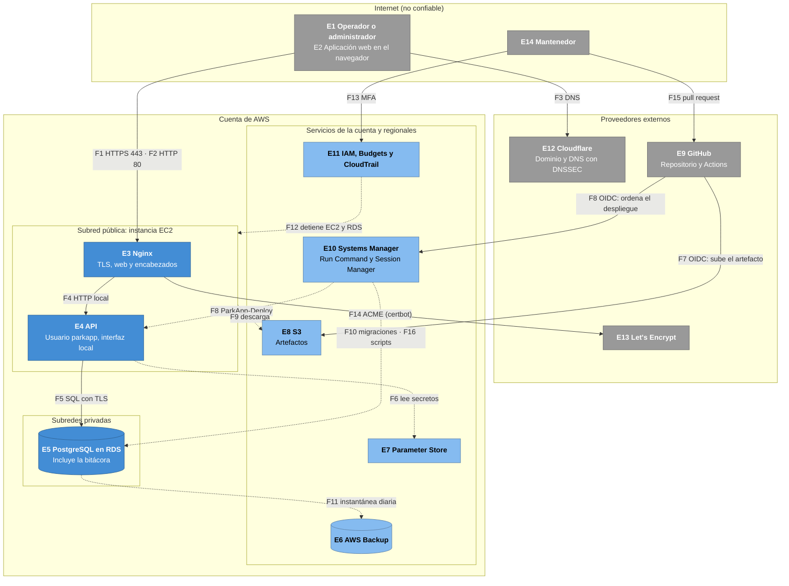

# Modelo de amenazas

| Campo | Valor |
|---|---|
| Proyecto | RoloPark — Sistema de Gestión de Parqueaderos |
| Tarea | S2-13 (#8); actualizado en S2-10 (#40), S2-11 (#41), S2-12 (#42) y S2-25 (#48) |
| Versión | 1.4 — 13 de noviembre de 2026 |

RoloPark es el nombre visible del producto desde el 3 de noviembre de 2026 (S2-23,
#71). Los identificadores internos (repositorio, recursos de AWS, roles de la base
de datos y servicios) siguen como `parkapp`.

## 1. Propósito y alcance

Este documento identifica las amenazas al sistema con el método STRIDE por
elemento y relaciona cada una con su control, con el requisito, ADR o regla de
negocio que lo exige y con su estado. Los requisitos de seguridad ya existen
(NFR-01 a NFR-12, `docs/requisitos.md`, sección 3.1): el modelo no crea
requisitos nuevos, sino que muestra qué amenaza cubre cada uno y qué queda
pendiente.

**Dentro del alcance:** el navegador del usuario, Nginx, la API, la base de datos
en RDS, el despliegue desde GitHub Actions, la cuenta de AWS con sus servicios y
respaldos, y los proveedores externos de los que depende el sistema (Cloudflare y
Let's Encrypt).

**Fuera del alcance:** la seguridad física del parqueadero, un equipo del
operador ya comprometido (por ejemplo, con un programa que captura el teclado),
los procedimientos que las reglas dejan fuera del sistema (verificar los
documentos del propietario, BR-13, y resolver una diferencia de cobro, BR-17) y la
infraestructura interna de AWS, GitHub y Cloudflare.

**Categorías de STRIDE:**

| Letra | Categoría | Propiedad que se viola |
|---|---|---|
| S | Suplantación | Autenticidad |
| T | Manipulación | Integridad |
| R | Repudio | No repudio (trazabilidad) |
| I | Divulgación de información | Confidencialidad |
| D | Denegación de servicio | Disponibilidad |
| E | Elevación de privilegios | Autorización |

**Estados de un control:**

- **Implementado:** está en `main` o en AWS y se verificó; se indica la tarea.
- **Planeado:** tiene historia y sprint asignados; se indica cuál.
- **Residual:** el riesgo se acepta por ahora, con su razón y su fecha de
  revisión en la sección 8.

## 2. Elementos

| ID | Elemento | Tipo | Dónde está |
|---|---|---|---|
| E1 | Operador o administrador | Entidad externa | Navegador web en el parqueadero |
| E2 | Aplicación web (React) | Proceso | Corre en el navegador; la sirve Nginx |
| E3 | Nginx | Proceso | Instancia EC2, subred pública. Termina TLS, sirve la web y reenvía `/api` |
| E4 | API (Node.js con Express y Prisma) | Proceso | Instancia EC2, usuario del sistema `parkapp`, escucha solo en la interfaz local |
| E5 | Base de datos PostgreSQL 16 | Almacén de datos | RDS, subredes privadas. Incluye la bitácora de auditoría |
| E6 | Respaldos | Almacén de datos | AWS Backup (bóveda `parkapp-respaldos`) y respaldos automáticos de RDS |
| E7 | Secretos | Almacén de datos | Parameter Store (`/parkapp/prod/` y `/parkapp/admin/`) |
| E8 | Artefactos de despliegue | Almacén de datos | Bucket S3 privado |
| E9 | Repositorio y GitHub Actions | Entidad externa | GitHub |
| E10 | Systems Manager | Proceso | Run Command (`ParkApp-Deploy`) y Session Manager |
| E11 | Cuenta de AWS | Proceso | IAM, AWS Budgets y CloudTrail |
| E12 | Cloudflare | Entidad externa | Registrador del dominio y DNS de `rolopark.com` |
| E13 | Let's Encrypt | Entidad externa | Autoridad que emite el certificado TLS |
| E14 | Mantenedor de la plataforma | Entidad externa | Administra GitHub, AWS y Cloudflare |

## 3. Flujos de datos

| ID | Origen → destino | Datos | Canal | Límite que cruza |
|---|---|---|---|---|
| F1 | Navegador → Nginx | Páginas, credenciales, cookie de sesión y datos de estadías | HTTPS, puerto 443 | LC1 |
| F2 | Navegador → Nginx | Primera visita por HTTP | HTTP, puerto 80; solo redirección 301 | LC1 |
| F3 | Navegador → Cloudflare | Resolución de `rolopark.com` | DNS con DNSSEC | LC6 |
| F4 | Nginx → API | Peticiones a `/api` con `X-Forwarded-For` y `X-Forwarded-Proto` | HTTP en la interfaz local de la instancia | LC2 |
| F5 | API → base de datos | Consultas con el usuario `parkapp_app` | SQL con TLS, puerto 5432 | LC3 |
| F6 | API → Parameter Store | URL de conexión de `parkapp_app`, al arrancar | HTTPS, rol de la instancia | LC5 |
| F7 | GitHub Actions → S3 | Artefacto `.tar.gz` | HTTPS, credenciales temporales por OIDC | LC4 |
| F8 | GitHub Actions → Run Command → servidor | Orden de despliegue con `Commit` y `Sha256` | API de AWS, OIDC | LC4 y LC5 |
| F9 | Servidor → S3 | Descarga del artefacto | HTTPS, rol de la instancia | LC5 |
| F10 | `ParkApp-Deploy` → base de datos | Migraciones con `parkapp_migrator` | SQL con TLS | LC3 |
| F11 | AWS Backup → base de datos → bóveda | Instantánea diaria | Plano de control de AWS | LC5 |
| F12 | AWS Budgets → Automation → EC2 y RDS | Orden de detener | Plano de control de AWS | LC5 |
| F13 | Mantenedor → consola de AWS y Session Manager | Administración | HTTPS con MFA | LC5 |
| F14 | certbot (servidor) ↔ Let's Encrypt | Desafío ACME y certificado | HTTPS de salida y HTTP en la ruta de validación | LC6 |
| F15 | Mantenedor → GitHub | Cambios por pull request | HTTPS | LC4 (indirecto, por F7 y F8) |
| F16 | Mantenedor → Session Manager → scripts de arranque → base de datos | Cuenta del primer administrador, tarifas y periodo de gracia, con el usuario `parkapp_app`; la URL se lee de Parameter Store y la contraseña llega por la entrada estándar | Session Manager con MFA; SQL con TLS | LC5 y LC3 |

## 4. Límites de confianza

| ID | Límite | Qué lo protege |
|---|---|---|
| LC1 | Internet → servidor | Solo los puertos 443 y 80 están abiertos; el 80 solo redirige. Nginx rechaza IP y nombres desconocidos. TLS 1.2 y 1.3 |
| LC2 | Nginx → API, dentro de la instancia | La API escucha solo en la interfaz local y corre con otro usuario (`parkapp`). Nginx reemplaza los encabezados de reenvío, y la API confía solo en el proxy local |
| LC3 | Subred pública → subredes privadas | RDS sin acceso público ni ruta a internet. El grupo `parkapp-db` solo acepta el 5432 desde `parkapp-web`. TLS obligatorio |
| LC4 | GitHub → AWS | OIDC con el `sub` del repositorio y la rama `main`, sin llaves guardadas. Solo se puede subir el artefacto y ejecutar `ParkApp-Deploy` |
| LC5 | Plano de control de la cuenta de AWS | Roles de IAM con permisos mínimos para el servidor, Budgets y AWS Backup. Personas con MFA. CloudTrail |
| LC6 | Proveedores externos | Cuenta de Cloudflare con verificación en dos pasos, DNSSEC y CAA. Let's Encrypt validado por HTTP |

## 5. Diagrama

Cada recuadro es una zona de confianza; un flujo que pasa de un recuadro a otro
cruza un límite de la sección 4. Las líneas punteadas son del plano de control de
AWS.

## 6. Tabla STRIDE

Las tareas del Sprint 2 se citan por su ID (S2-XX); el detalle de cada una está
en su issue y en su pull request.

### 6.1 Borde: navegador, DNS y Nginx (E1 a E3, E12, E13; F1 a F3 y F14)

| ID | Elemento o flujo | STRIDE | Amenaza | Control | Referencia | Estado |
|---|---|---|---|---|---|---|
| A-01 | F1 | I | Alguien en la red lee credenciales, la cookie de sesión o los datos de estadías. | Solo TLS 1.2 y 1.3, con suites ECDHE (secreto hacia adelante) y sin tickets de sesión. Intercambio de llaves poscuántico (`X25519MLKEM768`) contra "guardar hoy, descifrar mañana". SSL Labs A+. | NFR-09 · ADR 0005 | Implementado (S2-06) |
| A-02 | F1, F2 | T | Degradación a HTTP para leer o alterar el tráfico (*SSL stripping*). | El puerto 80 solo redirige con 301 a `https://rolopark.com` (nombre fijo). HSTS de 2 años con `includeSubDomains` en todas las respuestas HTTPS. La cookie de sesión lleva `Secure` (sección 7). | NFR-09 · ADR 0003, 0005 | Implementado (S2-06; cookie con `Secure` en S2-10); sin `preload`: R9 |
| A-03 | F3, E12 | S | Respuestas DNS falsificadas llevan al usuario a otro servidor. | DNSSEC activo, con el registro DS publicado en `.com`. | ADR 0005 | Implementado (S2-06) |
| A-04 | E13 | S | Otra autoridad emite un certificado para `rolopark.com`. | Registro CAA que autoriza solo a `letsencrypt.org`. Universal SSL de Cloudflare desactivado, porque agregaba otras autoridades al CAA. | ADR 0005 | Implementado (S2-06) |
| A-05 | E12 | S, T | Alguien toma la cuenta de Cloudflare y cambia el DNS, el CAA o el DNSSEC. | Verificación en dos pasos en la cuenta. Registros sin proxy: el TLS termina en Nginx, no en Cloudflare. | ADR 0005 | Implementado (S2-06); cuentas de un solo mantenedor: R11 |
| A-06 | E3 | S, I | Escaneos por IP o con un `Host` inventado buscan otros sitios o el certificado. | Puerto 80 por IP o nombre desconocido: `return 444`. Puerto 443: `ssl_reject_handshake on`. Las redirecciones no usan `$host`. | NFR-09 | Implementado (S2-06) |
| A-07 | E3, E4 | I | Las respuestas revelan versiones del software, útiles para buscar vulnerabilidades. | `server_tokens off` en Nginx y `x-powered-by` deshabilitado en Express. | NFR-07 | Implementado (S2-02 y S2-06) |
| A-08 | F14, E3 | D | El certificado vence sin renovarse y el sitio deja de funcionar. | `certbot-renew.timer` (dos veces al día; renueva cuando faltan 30 días) con un hook que recarga Nginx; `certbot renew --dry-run` verificado. | ADR 0005 | Implementado (S2-06); sin monitor externo: R8 |

### 6.2 Aplicación web y sesión (E2, F1)

| ID | Elemento o flujo | STRIDE | Amenaza | Control | Referencia | Estado |
|---|---|---|---|---|---|---|
| A-09 | E2 | T, I | Un script inyectado (XSS) roba datos o actúa en nombre del usuario. | CSP `default-src 'self'; base-uri 'none'; object-src 'none'` sin excepciones: la compilación no tiene scripts ni estilos en línea, y `assetsInlineLimit: 0` evita los `data:`. React escapa el contenido. Probado con un script en línea inyectado a propósito: bloqueado. | ADR 0002 | Implementado (S2-08) |
| A-10 | E2 | I | Un XSS lee el token de sesión. | El token va en una cookie `HttpOnly`, no en `localStorage`. | ADR 0003 | Implementado (S2-10) |
| A-11 | E2 | T | *Clickjacking*: otro sitio carga la página en un marco invisible. | `frame-ancestors 'none'` en la CSP. | — | Implementado (S2-08) |
| A-12 | E2 | T | El navegador interpreta un archivo con otro tipo MIME (por ejemplo, como script). | `X-Content-Type-Options: nosniff` en todas las respuestas. | — | Implementado (S2-08) |
| A-13 | E2 | I | Las URL internas se filtran a otros sitios en el encabezado `Referer`. | `Referrer-Policy: same-origin`. No se usa `no-referrer` porque los navegadores enviarían `Origin: null` y fallaría la verificación de A-14. | ADR 0003 | Implementado (S2-08) |
| A-14 | F1, E4 | T, E | CSRF: otro sitio hace que el navegador envíe peticiones con la cookie de sesión, incluido un inicio de sesión con la cuenta del atacante. | Cookie `SameSite=Strict` y verificación exacta del encabezado `Origin` en toda petición que modifica datos; mismo origen, sin CORS. Especificación en la sección 7. | ADR 0002, 0003, 0008 | Implementado (S2-10), con las pruebas de la sección 7.4 |
| A-15 | F1, E4 | S | Toma de sesión con un token robado o adivinado. | Token aleatorio de 256 bits; en la base solo se guarda su hash SHA-256. Expira a los 30 minutos de inactividad y a las 12 horas; cerrar sesión o desactivar la cuenta lo revoca en el servidor. | NFR-04 · ADR 0003 | Implementado (S2-10) |
| A-16 | E4 | S | Fijación de sesión: el atacante deja en el navegador un token que conoce. | Cada inicio de sesión genera un token nuevo; la API solo acepta tokens cuyo hash está en la tabla `sesion`. | ADR 0003 | Implementado (S2-10) |
| A-17 | F1, E4 | S | Adivinación de contraseñas en línea o con listas de credenciales filtradas. | Mínimo 15 caracteres (S2-10). Lista de contraseñas filtradas, bloqueo tras 5 intentos fallidos y límite de peticiones (Sprint 3). | NFR-02, NFR-03, NFR-08 | Implementado en parte (S2-10: mínimo de 15 caracteres); lo demás planeado (Sprint 3); R1 |
| A-18 | E5 | I | Con una copia de la base, el atacante recupera las contraseñas. | Hash adaptativo con sal (argon2id); nunca texto plano. | NFR-01 | Implementado (S2-10) |

### 6.3 API y lógica de negocio (E4, F4)

| ID | Elemento o flujo | STRIDE | Amenaza | Control | Referencia | Estado |
|---|---|---|---|---|---|---|
| A-19 | E4 | E | Un operador ejecuta acciones de administrador (anular, configurar tarifas). | La API verifica el rol en cada petición según la matriz de permisos; responde 403 y registra `ACCESO_DENEGADO`. | NFR-05 · requisitos 1.2 | En parte: verificación básica en `/api/estadias` (S2-11): sin una sesión válida de una cuenta activa, 401 `NO_AUTENTICADO` antes de validar la entrada; los dos roles registran, listan y dan salida (S2-12). En `/api/tarifas` y `/api/periodo-gracia`, solo el administrador: a un operador se le responde 403 `ACCESO_DENEGADO` antes de validar la entrada, y el rechazo queda en la bitácora con el método y la ruta (S2-25). Matriz completa planeada (Sprint 3); R2 |
| A-20 | E4 | T | Inyección SQL. | Prisma usa consultas parametrizadas; toda entrada se valida contra un esquema. Los permisos de `parkapp_app` limitan el daño (A-29). | NFR-06 · ADR 0006 | Implementado en `/api/sesion` (S2-10) y en `/api/estadias` (S2-11: esquema del cuerpo y del parámetro `estado`, con 400 `ENTRADA_INVALIDA`; S2-12: el `id` de la salida, entero positivo sin ceros a la izquierda que cabe en INTEGER), y en `/api/tarifas` y `/api/periodo-gracia` (S2-25: esquema del cuerpo, con 400 `ENTRADA_INVALIDA`) |
| A-21 | E4 | T | El cliente envía horas, montos o tarifas para pagar menos. | El servidor asigna las horas; el cobro se calcula en el servidor con la tarifa y la gracia guardadas al ingreso. La API no recibe montos. | BR-11, BR-16 | Implementado: el servidor asigna la hora de ingreso y guarda en la estadía la tarifa y la gracia vigentes (S2-11); la salida no recibe cuerpo (lo que llegue se ignora), el servidor asigna la hora de salida y el usuario, y el cobro se calcula con `calculateFee` y la tarifa y la gracia guardadas en la estadía, con una prueba de integración de BR-11 que cambia la tarifa después del ingreso (S2-12). La web solo muestra el comprobante que responde la API |
| A-22 | E4 | T | Valores corruptos o alterados en la tarifa, la gracia o las horas producen un cobro equivocado (una salida anterior al ingreso daba −1 minutos y una tarifa en 0 cobraba $0, sin error). | `calculateFee` valida sus entradas y lanza `RangeError`. La prueba de RI-12 revisa cada minuto de un día con cuatro tarifas (5.764 casos). 23 pruebas y 100 % de cobertura en `fee.ts`. | BR-05 a BR-08 · RI-05, RI-09, RI-10, RI-12 · NFR-20 | Implementado (S2-09); CHECK de la base: R3 |
| A-23 | E4 | I | Los errores muestran trazas, consultas SQL o versiones. | Manejador de errores con la forma única del ADR 0008; el detalle queda solo en el registro del servidor. Un `RangeError` de `calculateFee` responde `ERROR_INTERNO`. | NFR-07 · ADR 0008 | Implementado (S2-10); el `RangeError` de `calculateFee` en la salida responde 500 `ERROR_INTERNO`, con el detalle solo en el registro del servidor y sin escribir nada (S2-12) |
| A-24 | E4 | R | Un usuario niega haber registrado una salida o una anulación. | Bitácora con quién, qué, cuándo y desde qué IP, en la misma transacción de la acción. | NFR-12 · BR-12 · RI-17, RI-18 | Implementado en el inicio de sesión y los scripts de arranque (S2-10) y en el ingreso (S2-11: `INGRESO_REGISTRADO` e `INGRESO_RECHAZADO_PLACA_ACTIVA`, con usuario e IP, en la misma transacción; el rechazo se confirma antes de responder 409) y en la salida (S2-12: `SALIDA_REGISTRADA` con usuario e IP, en la misma transacción que cierra la estadía y crea el comprobante; un 409 no se registra) y en la configuración (S2-25: `TARIFA_CAMBIADA` y `PERIODO_GRACIA_CAMBIADO` con usuario e IP cuando el cambio sale de la web, en la misma transacción que crea la versión; desde los scripts de arranque siguen como eventos del sistema) |
| A-25 | F4 | S | Un cliente falsifica su IP con `X-Forwarded-For` para evadir el límite de peticiones o alterar la bitácora. | Nginx reemplaza `X-Forwarded-For` y `X-Forwarded-Proto` en lugar de agregarles valores. La API escucha solo en la interfaz local y confía solo en ese proxy (`trust proxy` en `loopback`). | NFR-08, NFR-12 · arquitectura 6.3 | Implementado en Nginx (S2-06) y en la API (S2-10) |
| A-26 | E4 | I | La bitácora guarda contraseñas o tokens. | Ningún evento guarda contraseñas ni tokens; se prueba en la historia que registra cada evento. | RI-14 | Implementado (S2-10) en los eventos de la sesión y de los scripts de arranque; cada historia prueba los suyos |
| A-27 | E3, E4 | D | Muchas peticiones o cuerpos grandes saturan la API. | `client_max_body_size 64k` en Nginx y AWS Shield Standard (incluido). Límite de peticiones por IP (Sprint 3). | NFR-08 | Implementado en parte (S2-06); límite de peticiones planeado (Sprint 3); R6 |
| A-28 | E4 | D | El proceso de la API falla y el servicio queda caído. | systemd con `Restart=always`: volvió a escuchar unos 7 s después de matarlo. | NFR-17 | Implementado (S2-04) |

### 6.4 Base de datos y respaldos (E5, E6; F5, F10 y F11)

| ID | Elemento o flujo | STRIDE | Amenaza | Control | Referencia | Estado |
|---|---|---|---|---|---|---|
| A-29 | E5 | T, E | Con la API comprometida (por ejemplo, por inyección SQL), el atacante borra datos, altera la bitácora o cambia el esquema. | Roles separados con permisos mínimos: `parkapp_app` no tiene DELETE en ninguna tabla ni puede crear o modificar tablas; en la bitácora solo consulta e inserta; en tarifa, gracia y estadía solo actualiza columnas concretas; no tiene permisos sobre `_prisma_migrations`. Las migraciones usan `parkapp_migrator`. Una prueba guardiana falla si una tabla nueva queda sin permisos o si `_prisma_migrations` concede alguno. En producción, `parkapp_app` inserta en la bitácora pero no borra. | NFR-12 · RI-13, RI-14 · ADR 0006 | Implementado (S2-19) |
| A-30 | E5 | I | Acceso directo a la base desde internet. | Subredes privadas sin ruta a internet y sin acceso público. El grupo `parkapp-db` solo acepta el 5432 desde `parkapp-web` y no tiene salida. | NFR-09 · arquitectura 6.3 | Implementado (S2-01 y S2-04) |
| A-31 | F5, F10 | I, T | Intercepción o alteración del tráfico entre el servidor y la base. | `rds.force_ssl = 1` y verificación estricta del certificado de RDS en las dos conexiones (TLS 1.3 verificado). | NFR-09 | Implementado (S2-04) |
| A-32 | E5, E6 | I | Lectura de los discos o de las instantáneas. | Cifrado en reposo con KMS en RDS y en sus respaldos; disco de la instancia cifrado. | NFR-09 | Implementado (S2-04 y S2-21) |
| A-33 | E5, E6 | T, D | Pérdida o alteración de datos por una migración equivocada, un borrado o una corrupción. | AWS Backup: instantánea diaria a las 4:30 a. m. que se conserva 7 días. Respaldos de RDS con recuperación a un punto de las últimas 24 horas. Protección contra borrado. Respaldo bajo demanda antes de una migración que cambie tablas existentes. | NFR-18 · ADR 0009 | Implementado (S2-21); simulacro de restauración (Sprint 3); R4 y R5 |
| A-34 | E6, E11 | E | El rol de AWS Backup, con la política administrada, puede modificar cualquier base de la cuenta (contraseña del maestro, protección contra borrado, retención). | Deny explícito sobre `rds:ModifyDBInstance` y `rds:ModifyDBCluster`. Verificado con el simulador de políticas (`explicitDeny`) y con un respaldo exitoso con el Deny puesto. | ADR 0009 · arquitectura 6.4 | Implementado (S2-21) |

### 6.5 Secretos, servidor y cuenta de AWS (E7, E10, E11; F6, F12, F13 y F16)

| ID | Elemento o flujo | STRIDE | Amenaza | Control | Referencia | Estado |
|---|---|---|---|---|---|---|
| A-35 | E7, E9 | I | Un secreto queda en el repositorio o en un archivo del servidor. | Parameter Store con `SecureString`; la URL de conexión vive solo en la memoria del proceso. El artefacto se arma con una lista explícita que no incluye ningún `.env`. Secret Protection de GitHub, con protección de push: rechaza un push que contenga un secreto reconocido. | NFR-10 · ADR 0006 | Implementado (S2-04 y S2-05); Secret Protection verificado el 4 de noviembre de 2026 |
| A-36 | F6, E7 | E | Desde el servidor se lee la contraseña del maestro u otros parámetros de la cuenta. | Deny explícito sobre todo parámetro fuera de `/parkapp/prod/`; la contraseña del maestro está en `/parkapp/admin/`. Verificado: `AccessDeniedException`. | NFR-10 · ADR 0006 · arquitectura 6.4 | Implementado (S2-04) |
| A-37 | E4, E11 | E | Con la API comprometida, el atacante se mueve a otros recursos de AWS o toma el servidor. | Rol de la instancia mínimo (Session Manager, lectura de `/parkapp/prod/` y descarga del bucket). IMDSv2 con límite de saltos 1. La API corre como `parkapp`, sin shell, y no puede modificar su código (dueño `root`). systemd con `NoNewPrivileges`, `ProtectSystem=full`, `ProtectHome` y `PrivateTmp`. Salida de red solo por 443 y al 5432 de la base. | ADR 0004, 0006 · arquitectura 6.3 y 6.4 | Implementado (S2-04) |
| A-38 | E10 | E | Acceso al servidor por SSH con una llave robada o por fuerza bruta. | Sin puerto 22 ni par de llaves. La administración es solo por Session Manager, autenticado con IAM y MFA. | ADR 0007 | Implementado (S2-04) |
| A-39 | F13, E11 | S, E | Alguien usa credenciales robadas de la cuenta de AWS. | Usuario raíz con MFA y sin llaves de acceso. Administrador persona con MFA, solo consola y sin llaves. | ADR 0007 · arquitectura 6.4 | Implementado (S2-01) |
| A-40 | E11 | R | Se niega o no se puede reconstruir una acción administrativa en AWS. | Historial de CloudTrail de 90 días; las sesiones de Session Manager quedan a nombre de la persona. | ADR 0007 | Implementado (S2-01 y S2-04) |
| A-41 | E11 | D | Un gasto descontrolado (minería en un servidor comprometido, un error de configuración o tráfico) agota los créditos y cierra la cuenta. | AWS Budgets de 30 USD sin créditos: alerta al 80 % y dos acciones automáticas al 100 % que detienen EC2 y RDS. Probado de punta a punta con un presupuesto temporal. | NFR-23 | Implementado (S2-07); R7 |
| A-42 | F12, E11 | E | Se abusa del rol de Budgets (*confused deputy*) para encender, borrar o modificar recursos. | Confianza solo en `budgets.amazonaws.com`, con `aws:SourceAccount` y `aws:SourceArn`. Política propia: solo detiene la instancia y la base del proyecto, solo a través de SSM (`aws:CalledVia`) y solo con los documentos de detener. Access Analyzer sin hallazgos; en el simulador, iniciar, terminar, borrar y modificar dan `implicitDeny`. | NFR-23 · arquitectura 6.4 | Implementado (S2-07) |
| A-51 | F16, E10 | I | La contraseña del primer administrador queda en el historial de la terminal, en la lista de procesos o en la salida del script. | El script la recibe por la entrada estándar, nunca como argumento: se lee con `read -s` y se envía con `printf`, que es un comando interno de bash. El historial guarda solo el nombre de la variable. El script se niega a leerla de una terminal y no la imprime. | NFR-10 · RI-14 | Implementado (S2-10) |
| A-52 | F16, E5 | T, R, E | Los scripts de arranque sobrescriben la contraseña de una cuenta existente, cargan una tarifa ilegal o cambian la configuración sin dejar rastro. | Corren solo por Session Manager (IAM con MFA; la sesión queda a nombre de la persona en CloudTrail) y con `parkapp_app`, no con el maestro. Nunca modifican una cuenta existente. La tarifa no puede superar el tope legal vigente y solo se carga a nombre de una cuenta de administrador activa. Cada cambio crea una versión nueva y queda en la bitácora como evento del sistema, sin usuario ni IP. | NFR-12 · BR-10, BR-11, BR-15 · RI-18 · ADR 0006 | Implementado (S2-10) |

### 6.6 Despliegue (E8, E9, E10; F7 a F9 y F15)

| ID | Elemento o flujo | STRIDE | Amenaza | Control | Referencia | Estado |
|---|---|---|---|---|---|---|
| A-43 | F7, F8 | S | Otro repositorio, otra rama o un repositorio que reutilice el nombre asume el rol de despliegue. | OIDC: el rol exige `aud = sts.amazonaws.com` y un `sub` exacto (`StringEquals`) con los ID inmutables del dueño y del repositorio y la rama `main`. No hay llaves de AWS guardadas en GitHub. | NFR-10 · ADR 0007 | Implementado (S2-05) |
| A-44 | F8, E10 | T, E | Un flujo comprometido ejecuta comandos arbitrarios en el servidor. | Documento propio `ParkApp-Deploy`, no `AWS-RunShellScript`: el rol solo puede ejecutarlo, y solo en instancias con `Proyecto=parkapp`. Los parámetros `Commit` (`^[0-9a-f]{7}$`) y `Sha256` (`^[0-9a-f]{64}$`) tienen `allowedPattern`: un `Commit` con `; id` se rechazó con `InvalidParameters`. | ADR 0007 | Implementado (S2-05) |
| A-45 | F7, F9, E8 | T | El artefacto se altera entre la compilación y el servidor. | El flujo calcula el SHA-256 y el documento lo verifica antes de extraer. Bucket privado, cifrado y solo con HTTPS. El código extraído es de `root`, así que la API no puede modificarlo. | ADR 0007 | Implementado (S2-05) |
| A-46 | E9 | T, E | Un script de instalación de npm malicioso obtiene credenciales de AWS o corre en producción. | Los scripts de npm (backend y web) corren solo en el job "Test and package", que no tiene `id-token`. El servidor no ejecuta `npm ci`: recibe el artefacto ya compilado. | NFR-11 · ADR 0007 | Implementado (S2-05 y S2-08) |
| A-47 | E9, F15 | T | Llega a `main` código sin revisar, que no compila o con errores de tipos. | Ruleset `protect-main`: pull request obligatorio, sin *force push* y con las verificaciones obligatorias "Backend tests and build" y "Web build" (incluye la revisión de tipos con `tsc`). | NFR-19 | Implementado (S2-03 y S2-08); sin análisis estático: R13 |
| A-48 | E9 | T | Una dependencia con una vulnerabilidad conocida llega a producción. | `npm audit` al cierre de cada sprint en el backend y en la web; `package-lock.json` versionado. El 4 de noviembre de 2026: 0 vulnerabilidades en los dos. | NFR-11 | Implementado; advertencias aceptadas en #5, resueltas: R12 |
| A-49 | E9 | I | Los registros públicos de GitHub Actions revelan datos de la infraestructura. | El ARN del rol, el bucket y la instancia son secretos de GitHub; `mask-aws-account-id: true`. El flujo no imprime la salida de Run Command (muestra el servidor de RDS), solo su estado. | NFR-10 | Implementado (S2-05) |
| A-50 | E9, E14 | S, T | Alguien toma la cuenta de GitHub del mantenedor, fusiona código malicioso y lo despliega. | Verificación en dos pasos en GitHub, activada el 4 de noviembre de 2026 por un hallazgo de este modelo: hasta ese día, la cuenta entraba solo con contraseña, mientras AWS y Cloudflare ya pedían un segundo factor. El despliegue pasa por las verificaciones obligatorias y por `ParkApp-Deploy`, con su vuelta atrás automática. | NFR-19 · ADR 0007 | Implementado (S2-13); un solo mantenedor: R11 |

## 7. Protección contra CSRF (ADR 0003)

Esta sección es la especificación que implementa S2-10 (US-01).

### 7.1 Por qué hacen falta dos controles

La cookie de sesión viaja sola en cada petición a `/api`, así que otro sitio
podría hacer que el navegador envíe una petición autenticada. `SameSite=Strict`
evita que el navegador mande la cookie desde otro sitio, pero un subdominio cuenta
como el mismo sitio, y la protección depende del navegador. La verificación de
`Origin` es independiente de la cookie y rechaza también las peticiones que vengan
de un subdominio. El inicio de sesión también se protege: sin la verificación,
otro sitio podría iniciar sesión en el navegador del operador con la cuenta del
atacante (*login CSRF*).

### 7.2 Cookie de sesión

| Atributo | Valor | Motivo |
|---|---|---|
| Nombre | `sesion` | Contrato en español (ADR 0008). |
| Valor | Token aleatorio de 256 bits en base64url | En la base solo se guarda su hash SHA-256 (ADR 0003). |
| `HttpOnly` | Sí | JavaScript no puede leerla (A-10). |
| `Secure` | Sí | Solo viaja por HTTPS (A-02). Los navegadores la aceptan también en `http://localhost`, así que funciona en desarrollo. |
| `SameSite` | `Strict` | No se envía desde otros sitios (A-14). |
| `Path` | `/api` | No se envía al pedir la página ni los archivos estáticos (ADR 0003). |
| `Domain` | Sin el atributo | La cookie queda solo para `rolopark.com`, sin subdominios. |
| `Max-Age` | 43200 (12 horas) | Igual al máximo de NFR-04. El servidor aplica además la expiración por inactividad de 30 minutos y la revocación; la cookie no reemplaza esas verificaciones. |

- Cada inicio de sesión exitoso crea una sesión y un token nuevos (A-16).
- Cerrar sesión revoca la sesión en la base y borra la cookie con el mismo nombre,
  `Path` y atributos (`res.clearCookie` con las mismas opciones).
- La API debe usar `app.set("trust proxy", "loopback")`, para que `req.secure` y
  `req.ip` reflejen lo que envía Nginx (A-25).

### 7.3 Verificación de `Origin`

1. **Qué peticiones:** toda petición a `/api` con un método distinto de `GET`,
   `HEAD` y `OPTIONS`. Incluye `POST /api/sesion` (iniciar sesión) y
   `DELETE /api/sesion` (cerrarla).
2. **Dónde:** en la cadena de middleware, antes de la sesión (arquitectura 5.1).
   Una petición rechazada no consulta la base ni toca la sesión.
3. **Regla:** el encabezado `Origin` debe existir y ser igual, carácter por
   carácter, al origen configurado. Se rechaza si falta, si vale `null` o si es
   cualquier otro valor. No se compara por prefijo, sufijo ni expresión regular
   (`https://rolopark.com.ejemplo.net` debe fallar), y no se usa `Referer` como
   respaldo: Chrome, Edge y Firefox (NFR-22) envían `Origin` en toda petición que
   no sea `GET` ni `HEAD`.
4. **Origen configurado:** variable de entorno `APP_ORIGIN`, opcional, con
   `https://rolopark.com` por defecto. Así, `start.sh` del servidor no cambia. En
   desarrollo, el `.env` local define `APP_ORIGIN=http://localhost:5173`: el proxy
   de Vite reenvía el `Origin` del navegador sin cambiarlo. `config.ts` valida al
   arrancar que sea un origen (esquema y nombre, con puerto opcional, sin ruta ni
   barra final) y, si no lo es, falla como con `PORT`.
5. **Respuesta al rechazar:** 403 con
   `{ "error": { "codigo": "ORIGEN_NO_PERMITIDO", "mensaje": "..." } }`. Es un
   código propio de la historia (ADR 0008 lo permite). No se usa
   `ACCESO_DENEGADO`, porque en el ADR 0008 ese código va unido al evento de
   auditoría de un rol sin permiso, y aquí puede no haber usuario.
6. **Registro:** el rechazo no va a la bitácora. Queda en el registro del servidor
   con el método, la ruta sin parámetros de consulta y el valor de `Origin`
   recibido; nunca la cookie.
7. **Rutas:** un `GET` nunca modifica datos (convención del ADR 0008). Es lo que
   permite no verificar `Origin` en los métodos seguros.
8. **Sin CORS:** la API no envía encabezados `Access-Control-Allow-*`, así que el
   navegador bloquea cualquier petición de otro origen que necesite verificación
   previa.
9. **Aplicación web:** usa URL relativas (`/api/...`) y el `fetch` por defecto,
   que envía la cookie solo al mismo origen. No usa `credentials: 'include'`. Los
   cuerpos van en JSON con `Content-Type: application/json`, y la API solo
   interpreta JSON (`express.json()`): un formulario de otro sitio no puede
   enviar JSON sin verificación previa. Es una tercera capa, no un control en el
   que se confíe.
10. **Nginx:** no necesita cambios. `proxy_pass` no toca `Origin`, y
    `Referrer-Policy: same-origin` (S2-08) hace que el navegador envíe el origen
    real en los `POST` y `DELETE` del mismo origen.

### 7.4 Pruebas para los criterios de S2-10

| Petición | Resultado esperado |
|---|---|
| `POST /api/sesion` sin `Origin` | 403 `ORIGEN_NO_PERMITIDO`; no se crea sesión ni evento de auditoría |
| `POST /api/sesion` con `Origin: null` | 403 `ORIGEN_NO_PERMITIDO` |
| `POST /api/sesion` con `Origin: https://ejemplo.net` | 403 `ORIGEN_NO_PERMITIDO` |
| `POST /api/sesion` con `Origin: https://rolopark.com.ejemplo.net` | 403 `ORIGEN_NO_PERMITIDO` |
| `POST /api/sesion` con `Origin: http://rolopark.com` (otro esquema) | 403 `ORIGEN_NO_PERMITIDO` |
| `POST /api/sesion` con `Origin: https://www.rolopark.com` | 403 `ORIGEN_NO_PERMITIDO` (`www` solo redirige) |
| `POST /api/sesion` con el origen configurado | Llega a la ruta (200, 400 o 401, según el cuerpo); nunca `ORIGEN_NO_PERMITIDO` |
| `DELETE /api/sesion` con una cookie válida y un `Origin` ajeno | 403 `ORIGEN_NO_PERMITIDO`, y la sesión sigue válida |
| `GET /api/salud` sin `Origin` | 200 (los métodos seguros no se verifican) |
| Inicio de sesión exitoso | `Set-Cookie` con `HttpOnly`, `Secure`, `SameSite=Strict`, `Path=/api` y `Max-Age=43200`, sin `Domain` |
| Arranque con `APP_ORIGIN=https://rolopark.com/` (barra final) | La API no arranca y el error nombra la variable |

### 7.5 Alternativas descartadas

- **Token anti-CSRF (sincronizado o de doble envío):** en el mismo origen, con
  `SameSite=Strict` y `Origin`, no agrega protección y obliga a la web a pedir y
  reenviar el token.
- **Encabezado `Sec-Fetch-Site`:** los navegadores de NFR-22 lo envían, pero sería
  una tercera verificación. Se puede agregar después sin cambiar la web.
- **Prefijo `__Host-` en la cookie:** exige `Path=/`, que contradice el ADR 0003.
  Ver R10.

## 8. Riesgos residuales

| ID | Riesgo | Por qué se acepta | Mitigación actual | Se revisa |
|---|---|---|---|---|
| R1 | En el Sprint 2 no hay límite de peticiones, bloqueo por intentos fallidos ni lista de contraseñas filtradas (NFR-02 en parte, NFR-03 y NFR-08). | Replaneación del 26 de octubre de 2026, según la capacidad medida. | Mínimo de 15 caracteres y argon2id (S2-10). En el Sprint 2 solo existe la cuenta del administrador. | Sprint 3 ("Harden sign-in") |
| R2 | La verificación del rol es básica; la matriz completa no se prueba (NFR-05). | Replaneación del 26 de octubre. | En el Sprint 2 solo hay un administrador: las cuentas de operador llegan con US-02 (Sprint 3). | Sprint 3 ("Test the full permission matrix") |
| R3 | La base no tiene los CHECK de integridad de RI-05, RI-09, RI-10 y RI-12 (S1-05, #6), ni el índice único parcial de una estadía activa por placa (BR-03): dos ingresos simultáneos de la misma placa podrían quedar activos. | Movidos al Sprint 3 en la replaneación. | Validación de `calculateFee` y prueba de RI-12 (S2-09); `UPDATE` solo por columna (S2-19). La API rechaza una placa con estadía activa con 409 (S2-11), y la web desactiva el botón de ingreso mientras espera la respuesta (no cubre dos dispositivos a la vez). | Sprint 3 (#6) |
| R4 | No hay aviso si un respaldo de AWS Backup falla. | El monitoreo se define en el Sprint 3. | Revisión manual con `aws backup list-backup-jobs`. | Sprint 3 (monitoreo) o backlog (aviso por SNS) |
| R5 | La recuperación a un punto en el tiempo cubre solo 24 horas, y los respaldos están en la misma cuenta y región: quien tome la cuenta podría borrar la base y sus respaldos. | Límites del plan gratuito (retención de RDS de 1 día y sin funciones entre regiones). | MFA en las personas, protección contra borrado, CloudTrail y el Deny del rol de respaldos. | Al pasar al plan de pago (ADR 0009) |
| R6 | No hay protección contra denegación de servicio de capa 7 (sin AWS WAF ni proxy de Cloudflare) y hay una sola instancia. | Costo, y NFR-16 pide 99 %, alcanzable con una instancia (ADR 0002, arquitectura 6.9). | AWS Shield Standard y el límite de 64 KB por petición; límite de peticiones en el Sprint 3. | Sprint 3 (NFR-08), y si un parqueadero empieza a usar la app |
| R7 | La acción de Budgets detiene el sistema sin aprobación, y no es un tope en tiempo real (Budgets se actualiza hasta tres veces al día; detener no deja el costo en cero; RDS se enciende sola a los 7 días). | Decisión del 2 de noviembre de 2026: no hay usuarios reales. | Alerta al 80 % por correo; encendido manual documentado. | Si un parqueadero empieza a usar la app |
| R8 | No hay monitor externo del vencimiento del certificado; Let's Encrypt ya no avisa por correo. | El monitoreo se define en el Sprint 3. | `certbot-renew.timer` renueva 30 días antes; el certificado actual vence el 30 de enero de 2027. | Sprint 3 (monitoreo) o backlog |
| R9 | HSTS sin `preload`: la primera visita de un navegador nuevo puede empezar por HTTP. | `preload` es difícil de revertir y obliga a todos los subdominios. | Redirección 301 a HTTPS con nombre fijo; cookie con `Secure`. | Si la app se ofrece a más parqueaderos (después de diciembre de 2026) |
| R10 | La cookie no usa el prefijo `__Host-`, porque el ADR 0003 fija `Path=/api`: un subdominio en manos de un atacante podría escribir cookies para el dominio. | Hoy no existe otro subdominio que `www`, que solo redirige desde el mismo Nginx. | DNS con verificación en dos pasos; la verificación exacta de `Origin` rechaza peticiones desde subdominios; cada inicio de sesión crea un token nuevo. | Si se agrega un subdominio |
| R11 | Una sola persona administra GitHub, AWS y Cloudflare, y nadie más revisa sus cambios. | Proyecto individual. | MFA o verificación en dos pasos en las tres cuentas (en GitHub, desde el 4 de noviembre de 2026); pull request y CI obligatorios; CloudTrail. | Si se suma otra persona al proyecto |
| R12 | **Resuelto.** Advertencias de dependencias transitivas de la CLI de Prisma, aceptadas en #5 (PR #19): GHSA-3f6p-5ww8-9rcr y GHSA-rgwj-5xj2-c3m3 de `mysql2` (dependencia de `prisma`), y GHSA-ggr8-5vv4-36mx de `deepmerge-ts` (dependencia de `@prisma/config`). Desde #57, la CLI es dependencia de producción y viaja en el artefacto. | — | Prisma 7.10.1 (#55) trae `mysql2` 3.24.4 y `deepmerge-ts` 8.0.2. `npm audit` del 4 de noviembre de 2026: 0 vulnerabilidades en el backend y en la web. | Cerrado; NFR-11 sigue con `npm audit` al cierre de cada sprint |
| R13 | No hay análisis estático de seguridad del código propio: CodeQL no está configurado en el repositorio. | No estaba en el alcance del Sprint 2, y el código propio todavía es pequeño (la verificación de salud y el cálculo del cobro). | TypeScript estricto, pruebas en la CI, revisión en cada pull request y `npm audit` para las dependencias. | Sprint 3 (configuración predeterminada de CodeQL, antes de las historias de cuentas y anulaciones) |

## 9. Mantenimiento del modelo

- El modelo se revisa al cierre de cada sprint (S2-18 y la revisión del Sprint 3).
- También se actualiza cuando una historia agrega un elemento, un flujo o un
  límite (por ejemplo, el monitoreo del Sprint 3 o un subdominio nuevo), o cuando
  cambia un control.
- Cuando una historia implementa un control **Planeado**, su pull request lo pasa
  a **Implementado** y cita la tarea.
- El documento no incluye números de cuenta, ARN, ID de recursos ni direcciones IP,
  porque el repositorio es público.

## 10. Referencias

- Shostack, A. (2014). *Threat Modeling: Designing for Security*. Wiley.
- Microsoft. *Microsoft Threat Modeling Tool threats* (categorías STRIDE).
  https://learn.microsoft.com/en-us/azure/security/develop/threat-modeling-tool-threats
- OWASP. *Cross-Site Request Forgery Prevention Cheat Sheet*.
  https://cheatsheetseries.owasp.org/cheatsheets/Cross-Site_Request_Forgery_Prevention_Cheat_Sheet.html
- `docs/requisitos.md` (sección 3.1), `docs/reglas-de-negocio.md`,
  `docs/modelo-datos.md` (reglas de integridad), `docs/arquitectura.md`
  (secciones 5 y 6) y los ADR 0002 a 0009.

## Historial de cambios

| Versión | Fecha | Cambios |
|---|---|---|
| 1.0 | 4 de noviembre de 2026 | Versión inicial: elementos, flujos, límites de confianza y diagrama; tabla STRIDE con los controles del Sprint 2; especificación de la protección contra CSRF para S2-10; riesgos residuales, con las advertencias de Prisma aceptadas en #5 marcadas como resueltas. Hallazgo: la cuenta de GitHub no tenía verificación en dos pasos; se activó el mismo día (A-50). (#8) |
| 1.1 | 7 de noviembre de 2026 | Cierre de S2-10: A-02 (cookie), A-10, A-14 a A-16, A-18, A-25 y A-26 pasan a Implementado; A-17, A-20, A-23 y A-24, en parte. Flujo F16 (scripts de arranque por Session Manager) y amenazas A-51 y A-52. (#40) |
| 1.2 | 10 de noviembre de 2026 | Cierre de S2-11: A-20 pasa a Implementado en `/api/estadias`; A-19 (verificación básica), A-21 (hora de ingreso, tarifa y gracia asignadas por el servidor) y A-24 (bitácora del ingreso y del rechazo), en parte. R3 incluye la falta del índice único de una estadía activa por placa. (#41) |
| 1.3 | 11 de noviembre de 2026 | Cierre de S2-12: A-21 (hora de salida y cobro en el servidor), A-23 (el `RangeError` de `calculateFee`) y A-24 (bitácora de la salida) pasan a Implementado. A-19 y A-20 incluyen la ruta de la salida. (#42) |
| 1.4 | 13 de noviembre de 2026 | S2-25 (US-11 y US-12): A-19 incluye la verificación del rol en `/api/tarifas` y `/api/periodo-gracia` (403 `ACCESO_DENEGADO` registrado en la bitácora); A-20, el esquema de esas rutas; y A-24, los cambios de tarifa y de periodo de gracia con usuario e IP desde la web. (#48) |
