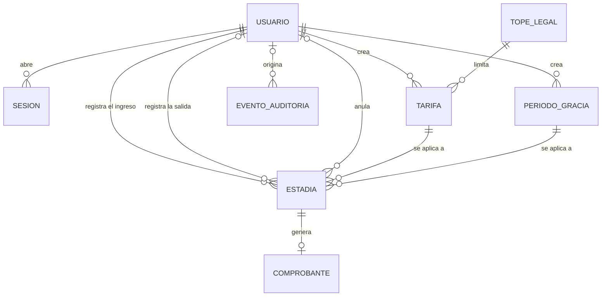
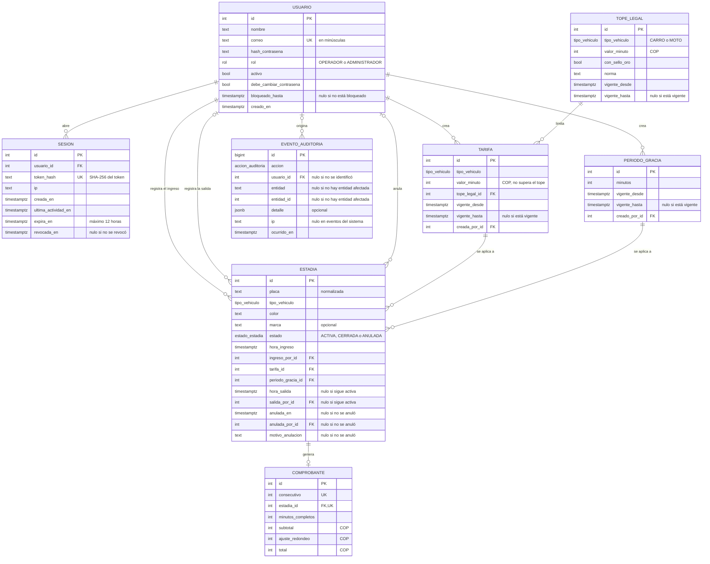

# Modelo de datos

| Campo | Valor |
|---|---|
| Proyecto | ParkApp — Sistema de Gestión de Parqueaderos |
| Tarea | S1-04 (#5) |
| Versión | 1.0 — 13 de octubre de 2026 |

Este documento se deriva de los requisitos (`docs/requisitos.md`) y de las
reglas de negocio (`docs/reglas-de-negocio.md`). Se desarrolla en tres niveles:
conceptual (qué entidades existen y cómo se relacionan), lógico (atributos,
claves y restricciones) y físico (esquema de Prisma sobre PostgreSQL).

## 1. Modelo conceptual

### 1.1 Entidades

| Entidad | Qué representa | Requisitos |
|---|---|---|
| Usuario | Persona que usa el sistema, con rol de operador o administrador. Se desactiva, nunca se borra. | FR-01 a FR-06 |
| Sesión | Sesión abierta de un usuario. Permite expirarla y revocarla de inmediato. | FR-01, FR-02, NFR-04 |
| Tope legal | Valor máximo por minuto aplicable al parqueadero, por tipo de vehículo, con la norma que lo origina. Solo cambia por migración. | BR-10, BR-15, FR-16 |
| Tarifa | Valor por minuto que cobra el parqueadero, por tipo de vehículo. Cada cambio crea una versión nueva. | BR-09, BR-10, BR-11, FR-16 |
| Periodo de gracia | Minutos iniciales sin cobro. Cada cambio crea una versión nueva. | BR-08, BR-11, FR-17 |
| Estadía | Paso de un vehículo por el parqueadero: datos del vehículo observados al ingreso, ingreso, salida y, si aplica, anulación. | BR-01 a BR-04, BR-11 a BR-13, BR-16; FR-07 a FR-12, FR-15 |
| Comprobante | Constancia del cobro de una estadía cerrada, con los valores aplicados. | BR-05 a BR-07, BR-14; FR-13, FR-14 |
| Evento de auditoría | Registro inmutable de una acción: quién, qué, cuándo y desde qué IP. | FR-19, NFR-03, NFR-05, NFR-12 |

FR-10, FR-11, FR-18 y FR-20 son consultas sobre Estadía y Comprobante; no
requieren entidades propias.

### 1.2 Diagrama

### 1.3 Decisiones de modelado

1. **No hay entidad Vehículo.** Los datos del vehículo (placa, tipo, color y
   marca) se guardan en cada estadía tal como se observaron al ingreso, y la
   verificación de salida (BR-04) se hace contra esa observación. No es
   redundancia: en el dominio, la placa no determina el color ni la marca. Una
   placa clonada (BR-03) son dos vehículos físicos con la misma placa, y una
   tabla de vehículos con la placa como clave los mezclaría en uno solo. Ningún
   requisito necesita un perfil de vehículo; las mensualidades están fuera de
   alcance.
2. **Las sesiones se guardan en el servidor.** NFR-04 exige que cerrar sesión o
   desactivar una cuenta invalide el acceso de inmediato, lo que solo es posible
   si el servidor consulta el estado de la sesión en cada petición. El mecanismo
   de transporte se decide en la arquitectura (S1-06).
3. **El sistema atiende un solo parqueadero**, como establece el anteproyecto.
   Por eso no hay entidad Parqueadero: el tope legal guarda el valor aplicable a
   este parqueadero, incluida la condición de Sello Oro y la norma que lo origina
   (BR-15). Atender varios parqueaderos queda en el backlog del producto.
4. **Toda salida genera un comprobante, aunque el cobro sea $0** por el periodo
   de gracia. Así, cada estadía cerrada tiene exactamente un comprobante, y el
   resumen de recaudo (FR-20) cuadra con las salidas registradas. El comprobante
   es una entidad propia porque es un documento con numeración consecutiva y
   con los valores cobrados, distinto del hecho de la estadía.
5. **La anulación es parte de la estadía.** Anular una estadía anula también su
   comprobante, si lo tiene (FR-15). Una estadía activa también se puede anular
   si se registró por error.

## 2. Modelo lógico

### 2.1 Convenciones

- Nombres en español, en minúscula, con guion bajo y sin tildes (`hora_ingreso`).
- Identificadores enteros secuenciales.
- Dinero en pesos colombianos enteros, sin decimales.
- Fechas y horas con zona horaria, siempre asignadas por el servidor (BR-16).
- Las entidades versionadas (tope legal, tarifa y periodo de gracia) usan
  `vigente_desde` y `vigente_hasta`; `vigente_hasta` nulo indica la versión
  vigente.
- El tipo, la obligatoriedad y la descripción de cada atributo se detallan en
  el diccionario de datos (sección 4).

### 2.2 Diagrama

### 2.3 Reglas de integridad

Cada regla se implementa en PostgreSQL y se verifica con pruebas automatizadas
en S1-05.

| ID | Regla | Origen |
|---|---|---|
| RI-01 | La placa se guarda en mayúsculas, sin espacios ni guiones, con el formato de su tipo: tres letras y tres números para carro; tres letras, dos números y una letra para moto. | BR-02, FR-08 |
| RI-02 | Una placa tiene como máximo una estadía activa. | BR-03, FR-09 |
| RI-03 | El estado de la estadía es coherente con sus datos: una activa no tiene salida; una cerrada tiene hora y usuario de salida; una anulada tiene fecha, usuario y motivo de anulación. | BR-12, FR-15 |
| RI-04 | Las únicas transiciones de estado válidas son de activa a cerrada, de activa a anulada y de cerrada a anulada. Una estadía anulada no cambia. | BR-12 |
| RI-05 | La hora de salida no es anterior a la de ingreso. | BR-16 |
| RI-06 | La tarifa de la estadía corresponde a su tipo de vehículo. La tarifa y el periodo de gracia son los vigentes al momento del ingreso. | BR-11 |
| RI-07 | Hay como máximo una versión vigente de tarifa y de tope legal por tipo de vehículo, y una de periodo de gracia. En toda versión, `vigente_hasta` es posterior a `vigente_desde`. | BR-11, BR-15 |
| RI-08 | Las versiones de tope legal, tarifa y periodo de gracia no se modifican; solo se cierran, una sola vez. | BR-11, BR-15 |
| RI-09 | La tarifa vigente es mayor que cero y no supera el tope legal vigente de su tipo de vehículo. Se verifica al crear una tarifa y al cambiar un tope. | BR-10, BR-15 |
| RI-10 | El periodo de gracia es un número entero de minutos mayor o igual a cero. | BR-08, US-12 |
| RI-11 | Toda estadía con salida registrada tiene exactamente un comprobante, y solo esas estadías lo tienen. La salida y el comprobante se registran en la misma transacción. | FR-13, FR-14 |
| RI-12 | En el comprobante, el total es el subtotal menos el ajuste por redondeo, el ajuste está entre $0 y $49, y el total es múltiplo de $50. Una vez emitido, no se modifica. | BR-06, BR-07, BR-12 |
| RI-13 | No se borran usuarios, estadías ni comprobantes. | BR-12; requisitos, sección 1.3 |
| RI-14 | La bitácora de auditoría es de solo inserción, y ningún evento guarda contraseñas ni tokens. | NFR-12 |
| RI-15 | El correo de cada usuario es único, sin distinguir mayúsculas de minúsculas. | FR-01 |
| RI-16 | Toda contraseña asignada por otra persona (cuenta nueva, restablecimiento o script de arranque) debe cambiarse en el primer inicio de sesión. | FR-03, FR-05; requisitos, sección 1.3 |
| RI-17 | En la bitácora, `entidad` y `entidad_id` van juntos: ambos tienen valor o ambos son nulos. | NFR-12; catálogo de la sección 4.1 |
| RI-18 | En la bitácora, la IP solo puede ser nula si el evento no tiene usuario, como en la creación del primer administrador con el script de despliegue. | NFR-12; catálogo de la sección 4.1 |

### 2.4 Decisiones del modelo lógico

1. **Identificadores enteros secuenciales.** El control de acceso es por rol,
   no por propiedad del registro: un operador puede consultar cualquier estadía
   activa. La seguridad no depende de que los identificadores sean difíciles de
   adivinar, sino de que la API verifique el rol en cada petición (NFR-05).
2. **Toda contraseña asignada por otra persona debe cambiarse** (RI-16). Si el
   administrador conociera la contraseña de un operador, podría actuar en su
   nombre, y se perdería la trazabilidad de quién hizo cada registro.
3. **Un cambio de tope no puede dejar ilegal la tarifa vigente** (RI-09). La
   migración que cambia un tope falla si la tarifa vigente lo supera; primero el
   administrador ajusta su tarifa. El sistema nunca cambia precios por su cuenta.
4. **El token de sesión se guarda como hash.** El cliente recibe un token
   aleatorio y la base solo guarda su huella SHA-256. Si la base se filtra, las
   sesiones activas no se pueden usar.
5. **El comprobante guarda los resultados del cálculo, no sus parámetros.**
   Minutos, subtotal, ajuste y total quedan fijos al emitirse, para que un cambio
   futuro en el código de cálculo no altere comprobantes ya emitidos. La tarifa y
   la gracia aplicadas no se copian: se obtienen de la estadía, y sus versiones
   son inmutables (RI-08).
6. **Los intentos fallidos se cuentan en la bitácora.** El bloqueo de NFR-03 se
   calcula con los eventos de inicio de sesión fallido de los últimos 15 minutos;
   el usuario solo guarda hasta cuándo está bloqueado.

## 3. Modelo físico

El esquema físico está en `backend/prisma/schema.prisma`, sobre PostgreSQL 16.
Las reglas de integridad que Prisma no puede declarar (CHECK, índices únicos
parciales y triggers) se agregan en S1-05.

### 3.1 Decisiones del modelo físico

1. **Nombres en inglés en el código y en español en la base.** Los modelos,
   atributos y valores de enumeración de Prisma usan los nombres en inglés del
   glosario. Las tablas, columnas y valores en la base usan los nombres en
   español del modelo lógico, mediante `@@map` y `@map`. Así, la base coincide
   uno a uno con el diagrama de la sección 2.2, y el código sigue la convención
   en inglés.
2. **Toda cuenta nueva debe cambiar su contraseña.** `debe_cambiar_contrasena`
   es verdadero por defecto, porque quien crea una cuenta conoce su contraseña
   inicial (RI-16).
3. **El consecutivo del comprobante puede tener saltos.** Lo genera una
   secuencia de PostgreSQL, que es única y creciente pero no reutiliza los
   números de transacciones revertidas. Es aceptable porque el comprobante no es
   una factura electrónica. Una numeración sin saltos exigiría bloquear un
   contador en cada salida, lo que obligaría a registrar las salidas una por
   una aunque haya varios operadores.
4. **Entidad e IP opcionales en la bitácora.** Algunos eventos no afectan una
    entidad, como un acceso denegado o un inicio de sesión fallido con un correo
    que no existe. Otros no vienen de una petición HTTP y no tienen IP, como la
    creación del primer administrador con el script de despliegue. Por eso
    `entidad`, `entidad_id` e `ip` son opcionales, con las condiciones de RI-17 y
    RI-18.

## 4. Diccionario de datos

### 4.1 Catálogo de acciones de auditoría

Cada evento de la bitácora registra quién actúa (`usuario_id`, nulo si nadie se
autenticó), sobre qué actúa (`entidad`, con el nombre de la tabla, y
`entidad_id`, ambos nulos si el evento no afecta una entidad), cuándo
(`ocurrido_en`) y desde qué IP (`ip`, nula en los eventos del sistema) (NFR-12).

`detalle` guarda solo lo que la entidad afectada no conserva; lo demás se
consulta en la propia entidad, que nunca se borra (RI-13). Así la bitácora no
duplica datos personales. `detalle` nunca guarda contraseñas, hashes, tokens,
cuerpos de petición, parámetros de consulta ni el correo escrito en un intento
fallido, porque un usuario puede escribir por error su contraseña en ese campo
(RI-14).

| Valor en la base | Nombre en código | Descripción | Origen | Entidad afectada | `detalle` | Lo dispara |
|---|---|---|---|---|---|---|
| INICIO_SESION_EXITOSO | LOGIN_SUCCEEDED | Inicio de sesión correcto; crea una sesión. | FR-01, FR-19 | sesion | — | Operador o administrador |
| INICIO_SESION_FALLIDO | LOGIN_FAILED | Intento de inicio de sesión rechazado. Es la base del bloqueo por intentos fallidos. | FR-01, FR-19, NFR-03 | usuario, si la cuenta existe; ninguna, si no | `motivo`: CREDENCIALES_INVALIDAS, CUENTA_DESACTIVADA, CUENTA_BLOQUEADA o CUENTA_INEXISTENTE | Persona no autenticada |
| ACCESO_DENEGADO | ACCESS_DENIED | Petición rechazada con 403 por no tener el rol requerido. | NFR-05 | ninguna | `metodo` y `ruta`, sin parámetros de consulta | Operador o administrador |
| INGRESO_REGISTRADO | ENTRY_REGISTERED | Ingreso de un vehículo. | FR-07, FR-19 | estadia | — | Operador o administrador |
| INGRESO_RECHAZADO_PLACA_ACTIVA | ENTRY_REJECTED_ACTIVE_PLATE | Ingreso rechazado porque la placa ya tiene una estadía activa (posible placa clonada). | BR-03, FR-09, FR-19 | estadia (la activa) | `tipo_vehiculo`, `color` y `marca` del vehículo rechazado | Operador o administrador |
| SALIDA_REGISTRADA | EXIT_REGISTERED | Salida de un vehículo y emisión de su comprobante, en la misma transacción (RI-11). | FR-12, FR-13, FR-14, FR-19 | estadia | — | Operador o administrador |
| ESTADIA_ANULADA | STAY_VOIDED | Anulación de una estadía y, si lo tiene, de su comprobante. | BR-12, FR-15, FR-19 | estadia | — (el motivo queda en la estadía) | Administrador |
| TARIFA_CAMBIADA | RATE_CHANGED | Creación de una nueva versión de tarifa. | FR-16, FR-19 | tarifa (la nueva versión) | — | Administrador |
| PERIODO_GRACIA_CAMBIADO | GRACE_PERIOD_CHANGED | Creación de una nueva versión del periodo de gracia. | FR-17, FR-19 | periodo_gracia (la nueva versión) | — | Administrador |
| CUENTA_CREADA | ACCOUNT_CREATED | Creación de una cuenta. | FR-03, FR-19 | usuario (la cuenta creada) | — | Administrador, o el sistema (script de arranque) |
| CUENTA_DESACTIVADA | ACCOUNT_DEACTIVATED | Desactivación de una cuenta; revoca sus sesiones. | FR-04, FR-19, NFR-04 | usuario | — | Administrador |
| CUENTA_REACTIVADA | ACCOUNT_REACTIVATED | Reactivación de una cuenta. | FR-04, FR-19 | usuario | — | Administrador |
| CONTRASENA_RESTABLECIDA | PASSWORD_RESET | Restablecimiento de la contraseña de un operador; revoca sus sesiones. | FR-05, FR-19, US-04 | usuario | — | Administrador |
| CONTRASENA_CAMBIADA | PASSWORD_CHANGED | Cambio de la propia contraseña, incluido el cambio obligatorio de RI-16. | FR-06, FR-19 | usuario | — | Operador o administrador |

El bloqueo de NFR-03 cuenta solo los eventos `INICIO_SESION_FALLIDO` con motivo
`CREDENCIALES_INVALIDAS` sobre la misma cuenta en los últimos 15 minutos. Los
intentos hechos mientras la cuenta está bloqueada no prolongan el bloqueo.

#### Eventos considerados y descartados

| Evento | Por qué no está en el catálogo |
|---|---|
| Cierre de sesión | FR-19 no lo exige, y queda en `sesion.revocada_en`. |
| Expiración de sesión | Se deduce de `expira_en` y `ultima_actividad_en`. |
| Bloqueo de cuenta | Se deduce de los intentos fallidos y queda en `usuario.bloqueado_hasta`. |
| Peticiones sin sesión (401) y exceso de peticiones (429) | No son acciones de negocio: van a los registros del servidor (NFR-07) y llenarían la bitácora sin aportar trazabilidad. |
| Emisión del comprobante como evento aparte | Es el mismo acto que la salida (RI-11). |
| Cambio de tope legal | No ocurre en la aplicación: queda en el commit de la migración y en la versión del tope, con su norma (BR-15). |
| Consultas (historial, bitácora y resumen) | Ningún requisito exige registrarlas. |

### 4.2 Atributos

**Columna** es el nombre en la base y **Código** el nombre en Prisma (`@map`).
**Tipo** es el tipo en PostgreSQL. Las restricciones que Prisma no declara
(CHECK, índices únicos parciales y triggers) se agregan en S1-05 y se citan por
su regla RI.

#### usuario (`User`)

| Columna | Código | Tipo | Obligatoria | Por defecto | Clave | Descripción |
|---|---|---|---|---|---|---|
| id | `id` | INTEGER | Sí | autoincremental | PK | Identificador del usuario. |
| nombre | `name` | TEXT | Sí | — | — | Nombre completo. |
| correo | `email` | TEXT | Sí | — | UK | Correo de inicio de sesión, en minúsculas (RI-15). |
| hash_contrasena | `passwordHash` | TEXT | Sí | — | — | Hash adaptativo con sal; nunca la contraseña (NFR-01). |
| rol | `role` | rol | Sí | — | — | OPERADOR o ADMINISTRADOR. |
| activo | `active` | BOOLEAN | Sí | true | — | Falso si la cuenta está desactivada; las cuentas no se borran (FR-04). |
| debe_cambiar_contrasena | `mustChangePassword` | BOOLEAN | Sí | true | — | Verdadero si la contraseña fue asignada por otra persona (RI-16). |
| bloqueado_hasta | `lockedUntil` | TIMESTAMPTZ(3) | No | — | — | Fin del bloqueo por intentos fallidos; nulo si no está bloqueada (NFR-03). |
| creado_en | `createdAt` | TIMESTAMPTZ(3) | Sí | CURRENT_TIMESTAMP | — | Creación de la cuenta. |

#### sesion (`Session`)

| Columna | Código | Tipo | Obligatoria | Por defecto | Clave | Descripción |
|---|---|---|---|---|---|---|
| id | `id` | INTEGER | Sí | autoincremental | PK | Identificador de la sesión. |
| usuario_id | `userId` | INTEGER | Sí | — | FK → usuario | Dueño de la sesión. |
| token_hash | `tokenHash` | TEXT | Sí | — | UK | Huella SHA-256 del token; el token nunca se guarda (sección 2.4, decisión 4). |
| ip | `ip` | TEXT | Sí | — | — | IP desde la que se inició la sesión. |
| creada_en | `createdAt` | TIMESTAMPTZ(3) | Sí | CURRENT_TIMESTAMP | — | Inicio de la sesión. |
| ultima_actividad_en | `lastActivityAt` | TIMESTAMPTZ(3) | Sí | CURRENT_TIMESTAMP | — | Última petición; controla la expiración por 30 minutos de inactividad (NFR-04). |
| expira_en | `expiresAt` | TIMESTAMPTZ(3) | Sí | — | — | Expiración absoluta, máximo 12 horas después del inicio (NFR-04). |
| revocada_en | `revokedAt` | TIMESTAMPTZ(3) | No | — | — | Cierre de sesión o revocación; nulo si sigue vigente. |

#### tope_legal (`LegalCap`)

| Columna | Código | Tipo | Obligatoria | Por defecto | Clave | Descripción |
|---|---|---|---|---|---|---|
| id | `id` | INTEGER | Sí | autoincremental | PK | Identificador de la versión. |
| tipo_vehiculo | `vehicleType` | tipo_vehiculo | Sí | — | — | Tipo de vehículo al que aplica. |
| valor_minuto | `valuePerMinute` | INTEGER | Sí | — | — | Valor máximo por minuto en COP, IVA incluido (BR-09, BR-10). |
| con_sello_oro | `hasGoldSeal` | BOOLEAN | Sí | — | — | Verdadero si el valor corresponde al tope con Sello Oro (BR-15). |
| norma | `regulation` | TEXT | Sí | — | — | Norma que fija el tope, por ejemplo, Decreto 652 de 2025, art. 200. |
| vigente_desde | `validFrom` | TIMESTAMPTZ(3) | Sí | — | — | Inicio de la vigencia. No tiene valor por defecto: lo fija la migración según la norma. |
| vigente_hasta | `validTo` | TIMESTAMPTZ(3) | No | — | — | Fin de la vigencia; nulo si está vigente (RI-07). |

#### tarifa (`Rate`)

| Columna | Código | Tipo | Obligatoria | Por defecto | Clave | Descripción |
|---|---|---|---|---|---|---|
| id | `id` | INTEGER | Sí | autoincremental | PK | Identificador de la versión. |
| tipo_vehiculo | `vehicleType` | tipo_vehiculo | Sí | — | — | Tipo de vehículo al que aplica. |
| valor_minuto | `valuePerMinute` | INTEGER | Sí | — | — | Valor por minuto en COP, IVA incluido; mayor que cero y sin superar el tope (RI-09). |
| tope_legal_id | `legalCapId` | INTEGER | Sí | — | FK → tope_legal | Tope legal del mismo tipo de vehículo, vigente al crear la tarifa (RI-09). |
| vigente_desde | `validFrom` | TIMESTAMPTZ(3) | Sí | CURRENT_TIMESTAMP | — | Inicio de la vigencia. |
| vigente_hasta | `validTo` | TIMESTAMPTZ(3) | No | — | — | Fin de la vigencia; nulo si está vigente (RI-07). |
| creada_por_id | `createdById` | INTEGER | Sí | — | FK → usuario | Administrador que creó la versión. |

#### periodo_gracia (`GracePeriod`)

| Columna | Código | Tipo | Obligatoria | Por defecto | Clave | Descripción |
|---|---|---|---|---|---|---|
| id | `id` | INTEGER | Sí | autoincremental | PK | Identificador de la versión. |
| minutos | `minutes` | INTEGER | Sí | — | — | Minutos iniciales sin cobro; entero mayor o igual a cero (RI-10). |
| vigente_desde | `validFrom` | TIMESTAMPTZ(3) | Sí | CURRENT_TIMESTAMP | — | Inicio de la vigencia. |
| vigente_hasta | `validTo` | TIMESTAMPTZ(3) | No | — | — | Fin de la vigencia; nulo si está vigente (RI-07). |
| creado_por_id | `createdById` | INTEGER | Sí | — | FK → usuario | Administrador que creó la versión. |

#### estadia (`Stay`)

| Columna | Código | Tipo | Obligatoria | Por defecto | Clave | Descripción |
|---|---|---|---|---|---|---|
| id | `id` | INTEGER | Sí | autoincremental | PK | Identificador de la estadía. |
| placa | `plate` | TEXT | Sí | — | — | Placa normalizada (RI-01). |
| tipo_vehiculo | `vehicleType` | tipo_vehiculo | Sí | — | — | Tipo observado al ingreso. |
| color | `color` | TEXT | Sí | — | — | Color observado al ingreso (BR-02). |
| marca | `brand` | TEXT | No | — | — | Marca observada al ingreso. |
| estado | `status` | estado_estadia | Sí | ACTIVA | — | ACTIVA, CERRADA o ANULADA (RI-03, RI-04). |
| hora_ingreso | `entryTime` | TIMESTAMPTZ(3) | Sí | CURRENT_TIMESTAMP | — | Hora del servidor al registrar el ingreso (BR-16). |
| ingreso_por_id | `entryById` | INTEGER | Sí | — | FK → usuario | Usuario que registró el ingreso. |
| tarifa_id | `rateId` | INTEGER | Sí | — | FK → tarifa | Tarifa vigente al ingreso, del mismo tipo de vehículo (BR-11, RI-06). |
| periodo_gracia_id | `gracePeriodId` | INTEGER | Sí | — | FK → periodo_gracia | Periodo de gracia vigente al ingreso (BR-11, RI-06). |
| hora_salida | `exitTime` | TIMESTAMPTZ(3) | No | — | — | Hora del servidor al registrar la salida; nula si sigue activa (RI-05). |
| salida_por_id | `exitById` | INTEGER | No | — | FK → usuario | Usuario que registró la salida. |
| anulada_en | `voidedAt` | TIMESTAMPTZ(3) | No | — | — | Hora del servidor de la anulación. |
| anulada_por_id | `voidedById` | INTEGER | No | — | FK → usuario | Administrador que anuló la estadía. |
| motivo_anulacion | `voidReason` | TEXT | No | — | — | Motivo de la anulación, obligatorio si el estado es ANULADA (RI-03). |

#### comprobante (`Receipt`)

| Columna | Código | Tipo | Obligatoria | Por defecto | Clave | Descripción |
|---|---|---|---|---|---|---|
| id | `id` | INTEGER | Sí | autoincremental | PK | Identificador interno. |
| consecutivo | `number` | INTEGER | Sí | secuencia | UK | Número visible del comprobante; único y creciente, puede tener saltos (sección 3.1, decisión 3). |
| estadia_id | `stayId` | INTEGER | Sí | — | FK → estadia, UK | Estadía cobrada; tiene como máximo un comprobante (RI-11). |
| minutos_completos | `fullMinutes` | INTEGER | Sí | — | — | Minutos completos de la estadía (BR-06). |
| subtotal | `subtotal` | INTEGER | Sí | — | — | Minutos completos por tarifa, en COP; $0 si la estadía no superó la gracia (BR-08). |
| ajuste_redondeo | `roundingAdjustment` | INTEGER | Sí | — | — | Valor descontado por redondeo, entre $0 y $49 (BR-07, RI-12). |
| total | `total` | INTEGER | Sí | — | — | Subtotal menos el ajuste; múltiplo de $50 (RI-12). |

#### evento_auditoria (`AuditEvent`)

| Columna | Código | Tipo | Obligatoria | Por defecto | Clave | Descripción |
|---|---|---|---|---|---|---|
| id | `id` | BIGINT | Sí | autoincremental | PK | Identificador del evento. |
| accion | `action` | accion_auditoria | Sí | — | — | Una de las 14 acciones del catálogo (sección 4.1). |
| usuario_id | `userId` | INTEGER | No | — | FK → usuario | Quien actúa; nulo si nadie se autenticó. |
| entidad | `entity` | TEXT | No | — | — | Tabla afectada; nula si el evento no afecta una entidad (RI-17). |
| entidad_id | `entityId` | INTEGER | No | — | — | Registro afectado; nulo si y solo si `entidad` es nula (RI-17). |
| detalle | `detail` | JSONB | No | — | — | Solo lo que la entidad afectada no conserva; nunca contraseñas ni tokens (RI-14). |
| ip | `ip` | TEXT | No | — | — | IP de la petición; nula solo en eventos del sistema (RI-18). |
| ocurrido_en | `occurredAt` | TIMESTAMPTZ(3) | Sí | CURRENT_TIMESTAMP | — | Momento del evento. |

### 4.3 Tipos enumerados

| Tipo | Valor en la base | Código |
|---|---|---|
| rol | OPERADOR | `OPERATOR` |
| rol | ADMINISTRADOR | `ADMINISTRATOR` |
| tipo_vehiculo | CARRO | `CAR` |
| tipo_vehiculo | MOTO | `MOTORCYCLE` |
| estado_estadia | ACTIVA | `ACTIVE` |
| estado_estadia | CERRADA | `CLOSED` |
| estado_estadia | ANULADA | `VOIDED` |
| accion_auditoria | 14 valores | Ver la sección 4.1 |

### 4.4 Índices

| Tabla | Columnas | Propósito |
|---|---|---|
| usuario | correo (único) | Inicio de sesión por correo (RI-15). |
| sesion | token_hash (único) | Buscar la sesión de cada petición (NFR-04). |
| sesion | usuario_id | Revocar las sesiones de un usuario (NFR-04). |
| comprobante | consecutivo (único); estadia_id (único) | Numeración y un comprobante por estadía (RI-11). |
| tarifa, periodo_gracia y estadia | Cada clave foránea | Consultas por usuario, tarifa y periodo de gracia, como el filtro por operador del historial (FR-18) y el resumen de recaudo (FR-20). |
| evento_auditoria | usuario_id | Consultar los eventos de un usuario (FR-19). |
| evento_auditoria | (accion, entidad, entidad_id, ocurrido_en) | Contar los intentos fallidos de una cuenta en los últimos 15 minutos (NFR-03). |

Los índices para los demás filtros del historial (fechas y placa, FR-18) se
definen en el Sprint 3 con las pruebas de carga de NFR-14, para decidirlos con
mediciones y no por suposición.
